# Manual de uso del sistema YoUSAC

Este manual separa las instrucciones por los tres perfiles principales solicitados: estudiante, docente/catedrático y administrador. El auxiliar se incluye como una variante de apoyo cuando la cuenta tenga ese rol. Las opciones visibles dependen de los permisos asociados a la cuenta y del ambiente desplegado. La dirección de producción del sistema es https://yousac-thany.duckdns.org.

## 1. Acceso común

1. Abrir la URL del sistema y seleccionar **Iniciar sesión**.
2. Ingresar con correo institucional autorizado (@ing.usac.edu.gt o @ingenieria.usac.edu.gt) y contraseña, o usar **Ingresar con cuenta institucional** si el proveedor OAuth está habilitado en ese ambiente.
3. Si todavía no hay cuenta, usar **Créala aquí**. Seleccionar estudiante o docente y completar los datos requeridos. La contraseña debe tener al menos 8 caracteres; el carnet de estudiante debe tener de 8 a 10 dígitos, DPI exactamente 13 dígitos y fecha de nacimiento válida.
4. La cuenta docente creada por registro requiere autorización administrativa antes de publicar. Las cuentas de auxiliar y administrador deben ser asignadas por el equipo autorizado.
5. Para terminar, usar **Cerrar sesión** desde el menú del usuario.

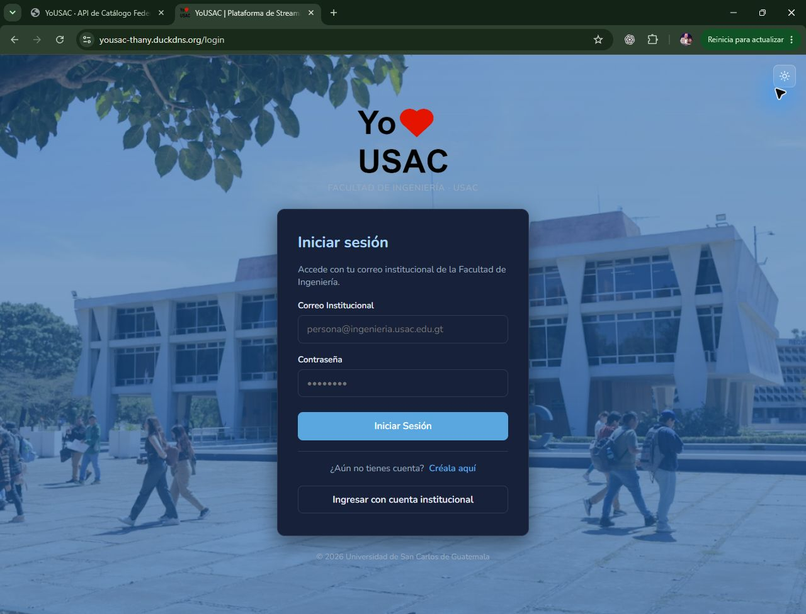

*Figura 1. Pantalla de acceso de YoUSAC.*

## 2. Estudiante

### 2.1 Explorar el catálogo

1. Abrir **Catálogo** desde el menú.
2. Buscar clases por título/tema y utilizar los filtros disponibles.
3. Las clases locales se abren desde su tarjeta. Las clases federadas se identifican como contenido externo; revisar su origen y abrir el detalle disponible. La disponibilidad de reproducción depende del enlace y del servicio que las comparte.
4. En una clase local, usar el reproductor y la barra de progreso para continuar desde el avance guardado. Si hay capítulos, seleccionar uno para saltar a esa parte.

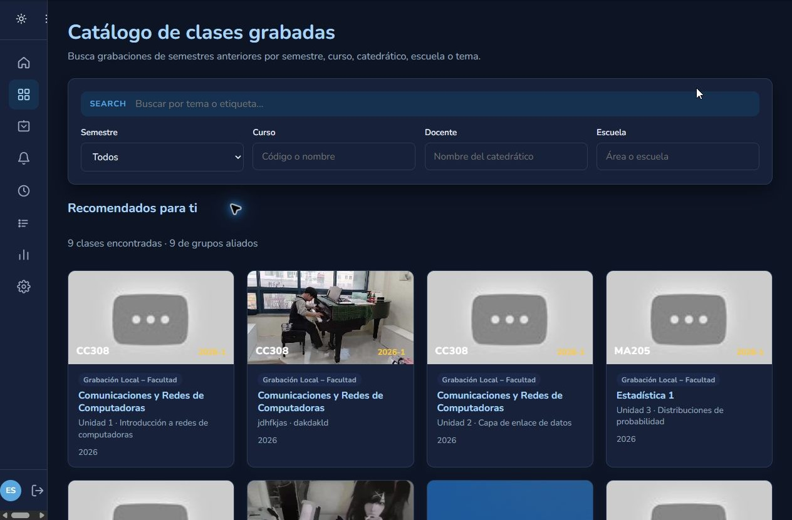

*Figura 2. Catálogo del estudiante con búsqueda y filtros.*

### 2.2 Reproducción y capítulos

1. En una clase con video disponible, usar el reproductor y la barra de progreso para continuar desde el avance guardado.
2. Si la clase tiene capítulos, seleccionar uno para saltar a esa parte.

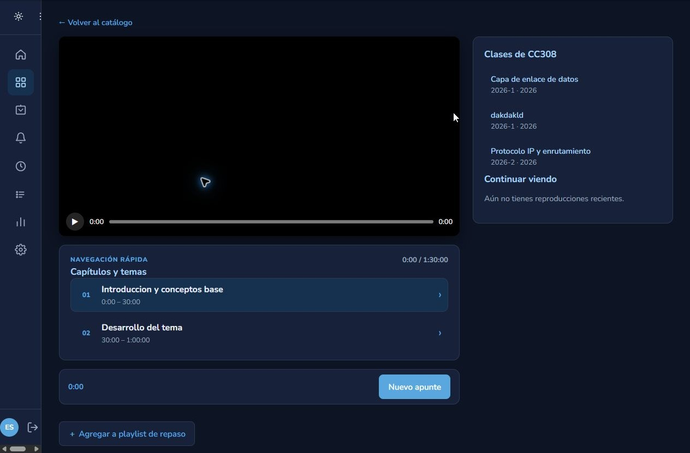

*Figura 3. Reproductor y capítulos de una clase.*

### 2.3 Apuntes, foro y materiales

1. En el reproductor, abrir **Apuntes** para crear o editar notas Markdown asociadas al momento de reproducción. Guardar los cambios; el editor también ofrece exportar el apunte como Markdown o PDF.
2. En **Foro de dudas**, escribir la pregunta mientras se reproduce el tema. La posición del video se adjunta a la duda. Abrir el hilo para responder; el autor de la duda o un usuario docente puede marcar una respuesta como verificada.
3. Usar **Ver en el video** para regresar al minuto de la conversación.
4. Abrir **Material del Curso** para consultar y descargar los archivos publicados por el equipo docente.

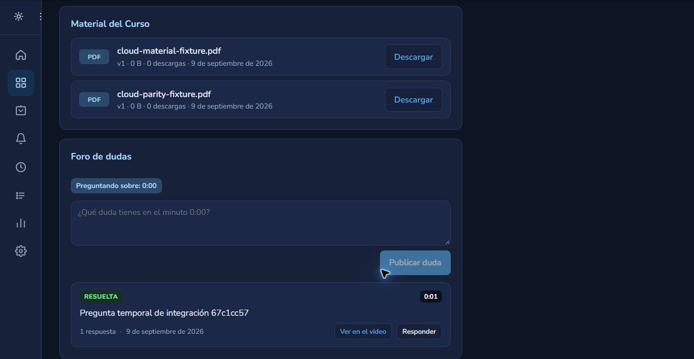

*Figura 4. Foro de dudas de una clase.*

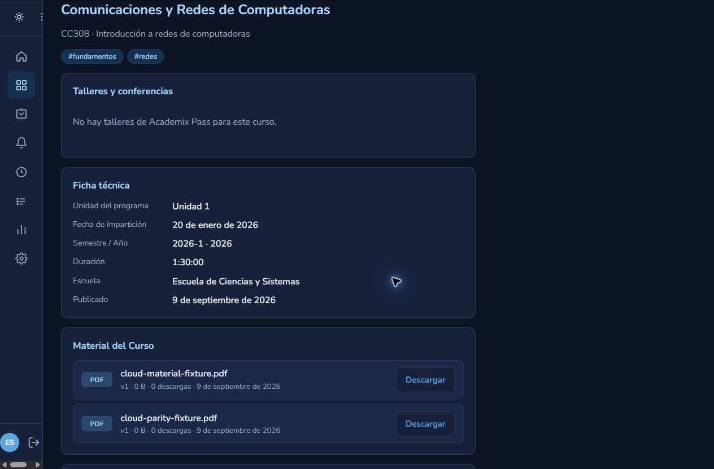

*Figura 5. Sección de materiales de una clase.*

### 2.4 Playlists, talleres y certificados

1. Abrir **Playlists** para crear una lista, añadir clases, cambiar su visibilidad o compartir el enlace público cuando esté habilitado.
2. En el detalle de una clase, revisar **Talleres y conferencias**. Si hay cupos, seleccionar **Reservar** y consultar el estado desde la misma integración.
3. En **Mi perfil > Mis certificados**, consultar y descargar credenciales disponibles. Utilizar el código de una credencial para verificarla cuando sea necesario.

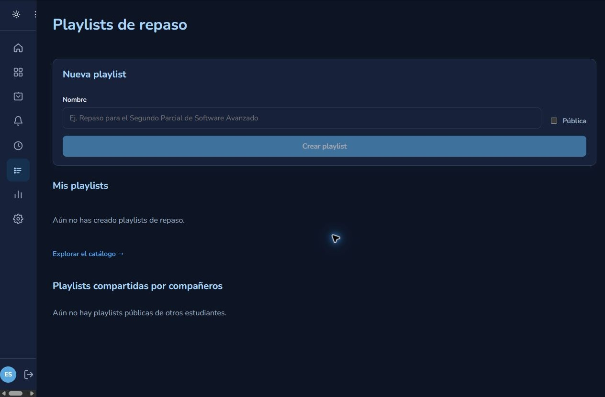

*Figura 6. Sección de playlists del estudiante.*

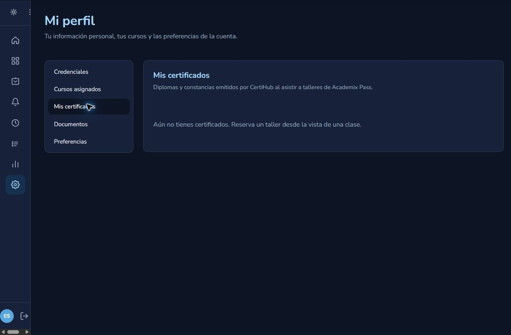

*Figura 7. Sección de certificados del estudiante.*

## 3. Docente y auxiliar

Esta sección corresponde al perfil docente/catedrático; también se documenta por separado el auxiliar como variante de apoyo. Sus permisos, cursos y opciones dependen de las asignaciones activas.

### 3.1 Catedrático

1. Entrar con la cuenta de catedrático aprobada y abrir **Gestión Académica** para revisar los cursos y asignaciones que tiene disponibles.
2. Abrir **Gestión de Contenido** y seleccionar únicamente un curso autorizado.
3. Elegir **Subir clase** para publicar contenido nuevo, o abrir una clase existente para editarla si la opción está habilitada.

En **Gestión de Contenido** se encuentran las opciones para subir grabaciones y materiales, además de la carga masiva. Si aparece el aviso de que no hay cursos asignados, solicita al administrador que vincule la cuenta docente al curso correspondiente.

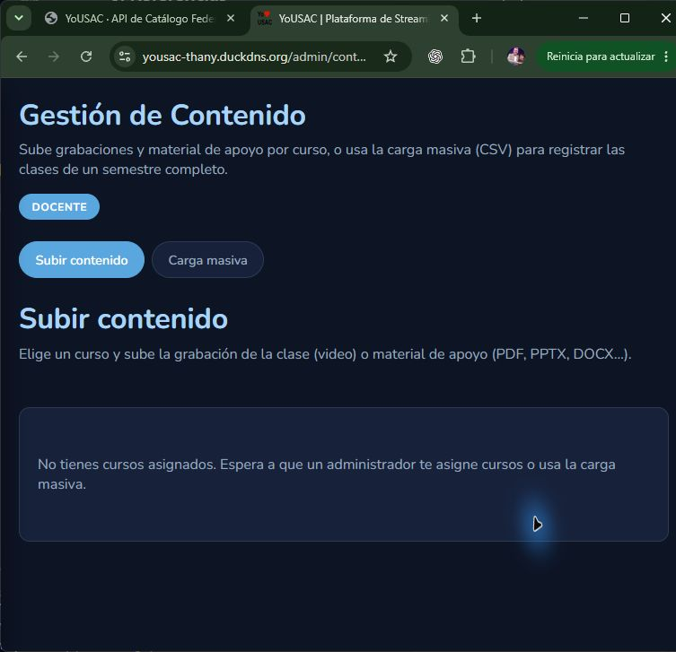

*Figura 8. Pantalla de Gestión de Contenido del perfil docente.*

### 3.2 Auxiliar

1. Entrar con la cuenta de auxiliar asignada y abrir **Mis cursos**.
2. Seleccionar un curso al que fue vinculado por el catedrático/administración y abrir la opción de contenido disponible.
3. Utilizar **Subir clase** o la acción de edición solo dentro de los cursos autorizados.

### 3.3 Publicar o actualizar una clase

Para cualquiera de los dos perfiles cuando el permiso esté habilitado:

1. Completar la ficha técnica, tema/título, etiquetas y participantes. Agregar el video mediante archivo o URL de YouTube según las opciones del formulario.
2. Si corresponde, adjuntar material de apoyo al repositorio del curso. Revisar la información antes de **Publicar clase**.
3. Para editar contenido existente, abrir la clase y utilizar la opción disponible para el rol.

### 3.4 Carga masiva mediante CSV

1. Abrir **Gestión de Contenido > Carga masiva**.
2. Seleccionar o pegar el CSV de clases con el formato preparado por el equipo. Revisar encabezados y filas antes de procesarlo.
3. Seleccionar **Procesar CSV** y revisar el resumen de registradas/omitidas o los errores reportados.
4. Confirmar en el catálogo que las clases esperadas quedaron disponibles. No cargar dos veces el mismo archivo sin revisar el resultado previo.

La carga masiva está disponible para los perfiles autorizados por el sistema (administrador, catedrático y auxiliar). Mantener el CSV en el almacenamiento de trabajo autorizado y no adjuntar información estudiantil innecesaria.

### 3.5 Capítulos, materiales y foro

1. Abrir una clase autorizada y utilizar **Establecer capítulos** para añadir, editar o eliminar segmentos con título y posición temporal.
2. En **Material de apoyo**, publicar o reemplazar un recurso permitido. Confirmar que el estudiante pueda consultarlo desde la clase.
3. Revisar las dudas del **Foro de dudas**, responder consultas y, cuando corresponda, marcar una respuesta como verificada. El sistema no presenta aquí una consola separada de moderación; las acciones dependen del rol y la clase.

## 4. Administrador

### 4.1 Dashboard y analítica

1. Abrir **Dashboard** para consultar el resumen de cursos, grabaciones, escuelas y semestres.
2. Revisar distribución de vistas, tendencias y calificaciones promedio.
3. Abrir **Analítica** para consultar rankings y ajustar los filtros temporales disponibles.

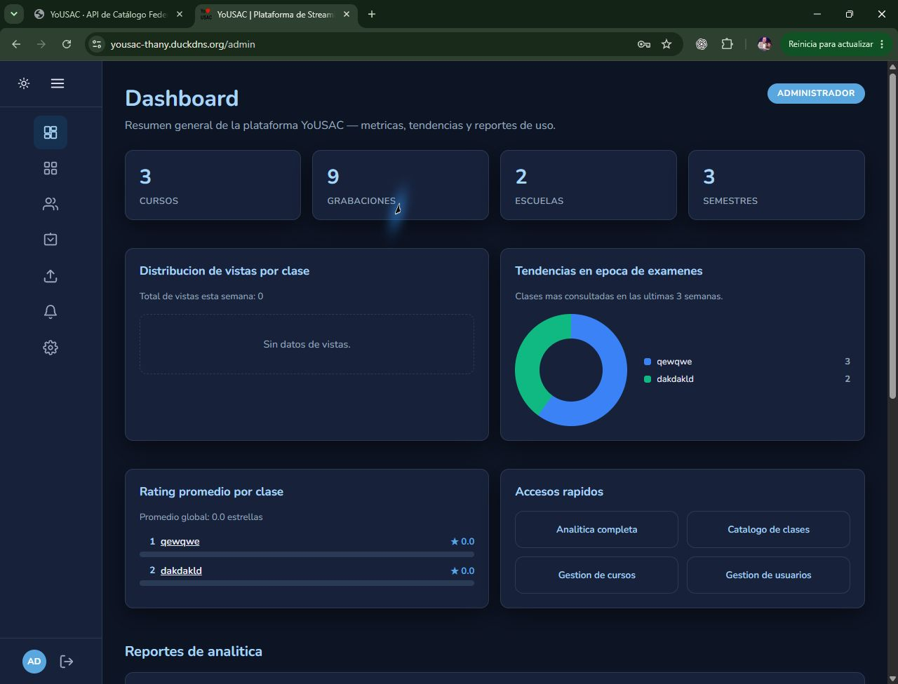

*Figura 9. Dashboard administrativo.*

### 4.2 Gestión académica, usuarios y contenido

1. En **Gestión Académica**, crear/editar semestres, escuelas y cursos, y administrar asignaciones de catedráticos/auxiliares según las opciones de la pantalla.
2. En **Gestión de Usuarios**, revisar cuentas y roles. Desactivar/reactivar o editar solo con autorización y verificando la identidad correcta.
3. En **Gestión de Contenido**, publicar/editar clases, gestionar materiales y ejecutar la carga CSV. Verificar siempre el resumen antes de repetir una importación.
4. Autorizar cuentas docentes pendientes cuando corresponda a las reglas del equipo.

Las operaciones de edición, desactivación o eliminación pueden afectar datos compartidos; confirmar la selección y la autorización antes de guardar.

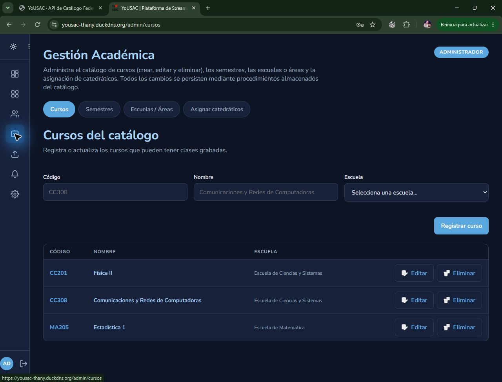

*Figura 10. Gestión académica: listado de cursos.*

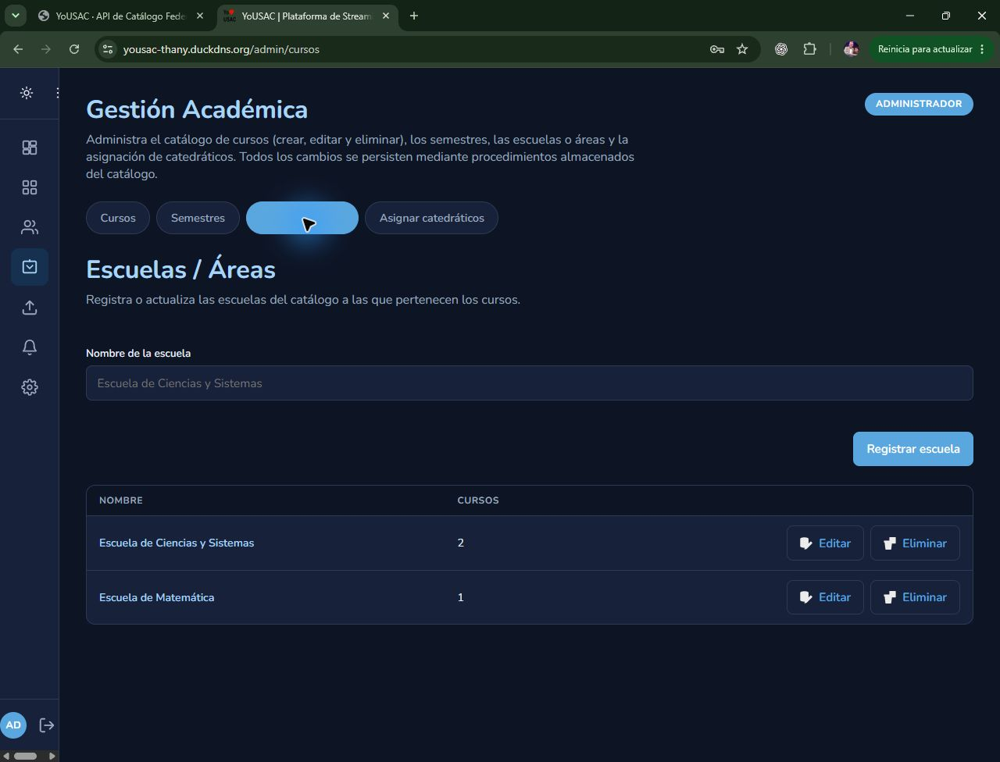

*Figura 11. Gestión académica: listado de escuelas.*

## 5. Ayuda y buenas prácticas

- Si un módulo no aparece, confirmar que la sesión tenga el rol/asignación apropiados y volver a iniciar sesión después de un cambio de permisos.
- Si un servicio externo no responde, conservar el mensaje de error y la hora; no compartir tokens ni capturas que muestren claves.
- No reutilizar cuentas o datos personales reales en capturas de la documentación.
- Reportar incidencias al equipo indicando ambiente, módulo, pasos realizados y resultado esperado/obtenido.

## 6. Referencias

- [Documento técnico consolidado YoUSAC Fase 3](YoUSAC_3.md)
- [Manual de despliegue Fase 3](Manual_Despliegue_Fase3.md)
