# Proyecto YoUSAC — Documento técnico consolidado de Fases 1, 2 y 3

## Integrantes

| Nombre | Carné |
|---|---|
| Marcos Geovani Barrios Lopez | 202300396 |
| Thanya Lisseth Mazariegos Morales | 202307691 |
| Abdiel Fernando Jose Otzoy Otzin | 202300350 |

## Índice
1. [Introducción](#introducción)
2. [Descripción del problema](#descripción-del-problema)
3. [Alcance del sistema](#alcance-del-sistema)
   - 3.1 [Alcance de Fase 2](#alcance-de-fase-2)
   - 3.2 [Alcance de Fase 3](#alcance-de-fase-3)
4. [Requerimientos del sistema](#requerimientos-del-sistema)
   - 4.1 [Requerimientos Funcionales (RF)](#requerimientos-funcionales-rf)
   - 4.2 [Requerimientos No Funcionales (RNF)](#requerimientos-no-funcionales-rnf)
   - 4.3 [Requerimientos Funcionales de Fase 2 (RF-F2)](#requerimientos-funcionales-de-fase-2-rf-f2)
   - 4.4 [Requerimientos No Funcionales de Fase 2 (RNF-F2)](#requerimientos-no-funcionales-de-fase-2-rnf-f2)
   - 4.5 [Trazabilidad y estado de Fase 2](#trazabilidad-y-estado-de-fase-2)
   - 4.6 [Requerimientos de Fase 3 y trazabilidad](#requerimientos-de-fase-3-y-trazabilidad)
5. [Modelo de Casos de Uso](#modelo-de-casos-de-uso)
   - 5.1 [Diagrama de alto nivel](#diagrama-de-alto-nivel)
   - 5.2 [Descomposición por módulo](#descomposición-por-módulo)
   - 5.3 [Casos de uso expandidos](#casos-de-uso-expandidos)
      - 5.3.7 [Módulo 7: Aprendizaje interactivo y recursos](#módulo-7-aprendizaje-interactivo-y-recursos)
   - 5.4 [Casos de uso de Fase 3](#casos-de-uso-de-fase-3)
6. [Vista de Arquitectura (Modelo 4+1)](#vista-de-arquitectura-modelo-41)
   - 6.1 [Vista de Escenarios](#vista-de-escenarios)
   - 6.2 [Vista Lógica](#vista-lógica)
   - 6.3 [Vista de Procesos](#vista-de-procesos)
   - 6.4 [Vista de Componentes](#vista-de-componentes)
   - 6.5 [Vista de Despliegue](#vista-de-despliegue)
7. [Diagrama de flujo del pipeline CI/CD](#diagrama-de-flujo-del-pipeline-cicd)
8. [Matriz de decisiones técnicas](#matriz-de-decisiones-técnicas)
9. [Matriz de aplicación SOLID en integraciones](#matriz-de-aplicación-solid-en-integraciones)
10. [Diseño del Modelado de Datos (DER)](#diseño-del-modelado-de-datos-der)
11. [Diseño UI/UX (Mockups)](#diseño-uiux-mockups)
12. [Manuales operativos complementarios](#manuales-operativos-complementarios)
   - 12.1 [Manual de despliegue](Manual_Despliegue_Fase3.md)
   - 12.2 [Manual de usuario](Manual_Usuario_Fase3.md)
13. [Conclusión](#conclusion)
---

## Introducción

Este documento consolida la especificación de Fases 1 y 2 —cuyo desarrollo previo se conserva en [YoUSAC_2.md](YoUSAC_2.md)— y la arquitectura, integración y operación añadidas en la Fase 3. Los requisitos heredados se mantienen identificables por fase; los diagramas y matrices marcados como F3 describen la topología vigente del repositorio. La documentación no sustituye la evidencia de ejecución en nube: cada estado se declara según el código, manifiestos y verificaciones disponibles.
El presente documento describe el análisis, diseño y planificación de la arquitectura del proyecto YoUSAC, una plataforma web de video bajo demanda (VOD) orientada al entorno universitario. Su principal objetivo es centralizar el acceso a las grabaciones de clases impartidas en semestres anteriores, permitiendo a los estudiantes consultar contenido académico, reforzar conocimientos y dar continuidad a su proceso de aprendizaje mediante una experiencia de navegación eficiente y segura.

Para satisfacer los requerimientos de escalabilidad, disponibilidad y alto rendimiento, el sistema se desarrolla siguiendo una arquitectura de microservicios políglota, distribuyendo las responsabilidades entre servicios implementados en Go, TypeScript y Python, cada uno especializado en un dominio específico del negocio. La comunicación entre los microservicios se realiza mediante gRPC y contratos definidos con Protocol Buffers, mientras que el acceso desde el cliente web se centraliza a través de un API Gateway, garantizando un punto de entrada único y seguro.

Asimismo, la solución incorpora mecanismos modernos de autenticación y autorización utilizando JWT, Session Cookies y OAuth 2.0, además de aplicar el patrón Database per Microservice, almacenamiento en caché con Redis, contenedores Docker y despliegue en Google Cloud Platform (GCP). Estas tecnologías permiten construir una plataforma desacoplada, mantenible y preparada para soportar un gran número de usuarios concurrentes.

En la Fase 3 se amplía el sistema con catálogo federado, integración server-to-server con Academix Pass & CertiHub, tareas programadas de seguridad y analítica, recomendaciones académicas, aprovisionamiento declarativo con Terraform, configuración de VMs con Ansible y observabilidad con Prometheus/Grafana y ELK. La topología implementada adopta recursos productivos existentes mediante bloques `import`; por tanto, la VPC de YoUSAC aloja las VMs de desarrollo y observabilidad y se conecta por peering a la red existente de GKE, sin afirmar que el clúster haya sido migrado a esa VPC.

## Descripción del problema
La Universidad San Carlos de Guatemala crear un sistema para centralizar el acceso a su acervo académico digital mediante una plataforma web de streaming de video bajo demanda (VOD) orientada al entorno universitario. El sistema permitirá a los estudiantes explorar, buscar y visualizar las grabaciones de las clases impartidas en semestres anteriores, facilitando el repaso de contenidos de cara a exámenes, laboratorios y autoformación.

Dado el elevado número de estudiantes conectados de forma concurrente en
periodos de evaluaciones y el volumen de contenido multimedia administrado, la
plataforma debe ser altamente escalable, tolerante a fallos y ofrecer bajos tiempos
de respuesta. Para maximizar el rendimiento y aprovechar las fortalezas específicas
de distintos lenguajes de programación, el departamento de ingeniería ha
determinado construir el sistema bajo una Arquitectura de Microservicios
Políglota.
De forma obligatoria, el backend implementará tres (3) lenguajes de programación
en simultáneo: Go, TypeScript y Python, distribuidos estratégicamente según el
dominio de cada microservicio.

TypeScript (Auth/Catálogo)
Go (Reproducción/Checkpoints)
Python (Analítica)

Toda la comunicación interna entre microservicios (east-west traffic) se realizará
mediante el protocolo síncrono gRPC sobre HTTP/2 con contratos estrictos Protocol
Buffers (.proto). La exposición externa de los servicios hacia el cliente web
(north-south traffic) se centralizará a través de un API Gateway.

La gestión de identidades se garantizará mediante JWT (JSON Web Tokens),
Session Cookies seguras y soporte para autorización delegada vía OAuth 2.0.
Asimismo, la persistencia seguirá el patrón Database per Microservice, integrando
lógica de datos programable en el motor de base de datos (procedimientos
almacenados, vistas, funciones y triggers).

## Alcance del sistema
1. Autenticación, Gestión de Sesiones y Multiperfil
2. Gestión de Inscripción y permisos
3. Catálogo, Búsqueda y Detalle de contenido
4. Servicio de Analítica, Tendencias y Recomendaciones
5. Historial de Reproducción Reciente y Checkpoint de Avance
6. Sistema de notificaciones por Correo

### Alcance de Fase 2

La Fase 2 documenta la evolución de YoUSAC hacia una plataforma de aprendizaje
interactivo y una operación cloud-native. Sobre las capacidades de Fase 1, el
alcance objetivo incorpora:

| Área | Alcance objetivo | Actores principales |
|---|---|---|
| Foro de dudas | Preguntas ancladas al segundo del video, marcadores en la barra, respuestas y verificación. | Estudiante, catedrático y auxiliar |
| Cuaderno Markdown | Edición enriquecida, marcas de tiempo, persistencia por estudiante y exportación. | Estudiante |
| Capítulos y temas | Gestión de intervalos temáticos y navegación directa desde el reproductor. | Catedrático y auxiliar |
| Materiales | Carga, consulta, descarga, versionado, métricas y validación de archivos. | Catedrático, auxiliar y estudiante |
| Playlists | Rutas de repaso con grabaciones o fragmentos, privadas o públicas. | Estudiante |
| Cloud-native y DevOps | Kubernetes/GKE, Ingress, servicios internos, persistencia, Registry y CI/CD. | Equipo de operación y desarrollo |

El alcance oficial se encuentra en `context/proyecto2.md`. La Práctica 4
(`context/practica4.md`) define el primer hito con documentación, capítulos,
materiales y pruebas base; `context/aclaraciones_practica4_fase2.md` complementa
las restricciones de arquitectura, Kubernetes, secretos, persistencia, CI/CD y
Pull Requests.

### Alcance de Fase 3

La tercera fase completa la interoperabilidad y el plano operativo cloud. El
alcance añadido, trazado a código/manifiestos, es:

| Área | Capacidad de Fase 3 | Evidencia principal |
|---|---|---|
| Federación académica | Consultar y reproducir grabaciones de otro grupo, validando el contrato y aislando errores remotos del catálogo local. | `Backend/api-gateway/src/federation/`, `Frontend/src/pages/CatalogPage.tsx`, `k8s/base/configmap.yaml` y Secret runtime. |
| Academix Pass & CertiHub | Listar talleres, solicitar reserva, consultar su estado y consultar/verificar certificados desde el perfil. | `Backend/api-gateway/src/academix/`, rutas `/academix/*` y `Frontend/src/components/TalleresPanel.tsx`, `BilleteraCertificados.tsx`. |
| Mantenimiento y analítica | Ejecutar purga de seguridad, recalcular tendencias y precalentar Redis; generar avisos de repaso asociados a evaluaciones próximas. | `k8s/base/cronjobs.yaml`, procedimientos y vistas SQL. |
| Recomendación | Calcular un puntaje explicable por valoraciones y reproducciones; exponerlo por gRPC/Gateway y presentarlo en Home. | `Backend/sql/analitica.sql`, `analitica-service`, `Frontend/src/pages/HomePage.tsx`. |
| IaC y configuración | Gestionar red, subredes, reglas, NAT, VMs y adopción de recursos existentes con Terraform; configurar las VMs mediante roles Ansible. | `infra/terraform/`, `infra/ansible/`. |
| Observabilidad | Recoger métricas de GKE/Gateway/Redis y logs de workloads/VMs; consultar dashboards de Grafana y Kibana. | `observability/`, `infra/ansible/roles/elk` y `fluent_bit`. |
| Entrega | Probar, construir y publicar ocho imágenes; aplicar despliegues a VM y GKE desde el flujo de CI/CD y ejecutar verificaciones de salud. | `.github/workflows/ci-cd.yml`, `deploy/k8s-deploy.sh`. |

Este documento conserva el contenido base de Fase 1 y agrega requisitos
identificados exclusivamente para Fase 2. Los IDs `RF-F2-##` y `RNF-F2-##`
evitan mezclar requisitos entre fases; la columna **ID consolidado** mantiene la
correspondencia con RF-16–RF-20 y RNF-11–RNF-18 cuando aplica.

## Requerimientos del sistema
### Requerimientos Funcionales (RF)

| ID | Requerimiento | Descripción | Prioridad |
|---|---|---|---|
| RF-01 | Autenticación institucional exclusiva | El sistema debe permitir registro y acceso únicamente con correo institucional de la Facultad de Ingeniería (@ingenieria.usac.edu.gt / @ing.usac.edu.gt) | Alta |
| RF-02 | Rechazo de correos personales/comerciales | El sistema debe rechazar el acceso con correos personales y comerciales (gmail, hotmail, etc.) | Alta |
| RF-03 | Gestión de sesiones (JWT + Session Cookies) | El sistema debe emitir y validar sesiones mediante JWT y Session Cookies (HttpOnly y Secure) | Alta |
| RF-04 | Login mediante OAuth 2.0 institucional | El sistema debe soportar login mediante OAuth 2.0 institucional | Media |
| RF-05 | Consulta de cursos, matrícula y credenciales | El sistema debe permitir al estudiante consultar sus cursos asignados/inscritos por semestre, el estado de su matriculación y credenciales académicas | Alta |
| RF-06 | Control de acceso basado en roles (RBAC) | El sistema debe controlar el acceso según rol correspondiente (RBAC): Estudiante, Catedrático/Docente, Auxiliar y Administrador | Alta |
| RF-07 | Búsqueda avanzada y filtrado de grabaciones | El sistema debe permitir una búsqueda avanzada y filtrado de grabaciones por Semestre/Año, Escuela, Curso, Catedrático y Temas | Alta |
| RF-08 | Vista detallada / ficha técnica de la clase | El sistema debe mostrar una vista detallada de la clase grabada con su respectiva ficha técnica de cada clase (unidad, fecha, sílabo/material adjunto, docentes/auxiliares) | Media |
| RF-09 | Cálculo de porcentaje de recomendación | El sistema debe calcular y mostrar el porcentaje de recomendación de una clase según valoraciones | Media |
| RF-10 | Registro de checkpoint de reproducción | El sistema debe guardar el checkpoint exacto donde el estudiante detuvo el video | Alta |
| RF-11 | Reanudación desde el último checkpoint | El sistema debe reanudar la reproducción desde el último checkpoint guardado | Alta |
| RF-12 | Cálculo de clases más vistas y mejor valoradas | El sistema debe calcular las clases más vistas por semana y el ranking de mejor valoradas | Media |
| RF-13 | Caché de consultas frecuentes (Redis) | El sistema debe cachear en Redis las consultas frecuentes de catálogo y tendencias | Media |
| RF-14 | Notificaciones automáticas por correo | El sistema debe enviar correos automáticos de confirmación de registro y de nuevas clases publicadas | Alta |
| RF-15 | Carga masiva de catálogo vía CSV | El sistema debe permitir la carga masiva de contenido/metadata del catálogo mediante archivos CSV | Media |

### Requerimientos No Funcionales (RNF)
| ID | Atributo de calidad | Especificación cuantitativa | Prioridad |
|---|---|---|---|
| RNF-01 | Rendimiento | El 95% de las peticiones al API Gateway deben responder en menos de 300ms | Alta |
| RNF-02 | Escalabilidad | El sistema debe soportar un número elevado de estudiantes, sobretodo en periodos de examenes | Alta |
| RNF-03 | Disponibilidad | El sistema debe mantenerse activo el 99% del tiempo.| Media |
| RNF-04 | Seguridad | Toda comunicación cliente-servidor debe usar HTTPS/TLS | Alta |
| RNF-05 | Seguridad | Las contraseñas/tokens no deben almacenarse en texto plano, debe usarse JWT con expiración ≤ 10 min | Alta |
| RNF-06 | Comunicación interna | El 100% del tráfico east-west entre microservicios debe usar gRPC | Alta |
| RNF-07 | Caché | Las consultas de catálogo/tendencias cacheadas deben tener TTL ≤ 10 minutos | Media |
| RNF-08 | Mantenibilidad | Código debe seguir principios SOLID y cada microservicio debe mantener cobertura de pruebas bastante considerable | Media |
| RNF-09 | Portabilidad | El sistema debe desplegarse mediante Docker Compose en entorno local y en la nube sin cambios de código | Alta |
| RNF-10 | Despliegue | El despliegue se debe realizar de forma obligatoria en Google Cloud Platform | Alta |

### Requerimientos Funcionales de Fase 2 (RF-F2)

Cada requisito funcional de esta sección describe una capacidad observable y su
criterio mínimo de aceptación. Los criterios son objetivos de diseño; el estado
actual del repositorio se informa en la matriz de trazabilidad.

| ID Fase 2 | ID consolidado | Actor(es) | Requerimiento | Criterio de aceptación | Prioridad |
|---|---|---|---|---|---|
| RF-F2-01 | RF-16 | Estudiante, catedrático y auxiliar | El sistema debe permitir crear preguntas ligadas al segundo actual del video, mostrar marcadores sobre la barra de progreso, responder dentro de un hilo y marcar una respuesta como correcta o verificada. | El timestamp debe estar dentro de la duración de la clase; el marcador debe abrir la pregunta y el hilo debe conservar autor, respuestas y estado de verificación. | Alta |
| RF-F2-02 | RF-17 | Estudiante | El sistema debe ofrecer un cuaderno de apuntes Markdown asociado al perfil, con inserción de marcas de tiempo y exportación. | Debe soportar encabezados, listas, bloques de código y fórmulas LaTeX; una referencia como `[18:45]` debe llevar al segundo correspondiente y la nota debe exportarse a `.md` o PDF. | Alta |
| RF-F2-03 | RF-18 | Catedrático y auxiliar | El sistema debe permitir crear, editar, eliminar, ordenar y consultar capítulos de una grabación, además de navegar a ellos desde el reproductor. | Cada capítulo debe tener inicio/fin enteros y no negativos, fin mayor que inicio, fin dentro de la duración, orden único y rango sin solapamiento; la barra e índice deben permitir saltar al inicio. | Alta |
| RF-F2-04 | RF-19 | Catedrático, auxiliar y estudiante | El sistema debe permitir cargar, consultar, descargar y versionar materiales asociados a una clase, registrar descargas y rechazar archivos no permitidos. | Cada carga debe validar MIME y extensión, sanitizar el nombre y aceptar como máximo 50 MB; la versión vigente y el contador de descargas deben ser visibles. | Alta |
| RF-F2-05 | RF-20 | Estudiante | El sistema debe permitir crear, nombrar, ordenar y compartir playlists con grabaciones o fragmentos de distintos cursos y semestres. | Una playlist privada solo debe ser visible para su propietario; una pública debe poder consultarse mediante un enlace compartible sin exponer playlists privadas. | Media |

### Requerimientos No Funcionales de Fase 2 (RNF-F2)

| ID Fase 2 | ID consolidado | Atributo de calidad | Criterio de aceptación medible | Prioridad |
|---|---|---|---|---|
| RNF-F2-01 | RNF-11 | Exposición de servicios | En producción, 100% del tráfico externo debe ingresar por Ingress; los servicios internos deben ser `ClusterIP` y deben existir 0 Services `NodePort` o `LoadBalancer`. | Alta |
| RNF-F2-02 | RNF-12 | Salud de despliegues | El 100% de los Deployments debe declarar y superar probes de liveness y readiness antes de recibir tráfico. | Alta |
| RNF-F2-03 | RNF-13 | Recursos y persistencia | El 100% de los Deployments debe declarar requests y limits de CPU y memoria; PostgreSQL y Redis deben estar fuera de pods efímeros o respaldados por persistencia configurada. | Alta |
| RNF-F2-04 | RNF-14 | Integración y entrega continua | En cada Pull Request y push a ramas principales deben ejecutarse las suites automatizadas de Go, TypeScript y Python; una falla debe detener build, publicación y despliegue. | Alta |
| RNF-F2-05 | RNF-15 | Imágenes y Container Registry | El 100% de las imágenes debe ser construido por CI/CD, publicado en un Registry y etiquetado con versión semántica; `latest` no puede ser la única referencia. | Alta |
| RNF-F2-06 | RNF-16 | Gestión de secretos | Debe existir 0 secretos en texto plano dentro del repositorio, Dockerfiles o manifiestos; las credenciales deben inyectarse mediante configuración segura. | Alta |
| RNF-F2-07 | RNF-17 | Carga segura de materiales | El 100% de las cargas debe pasar una allowlist de MIME/extensión, nombre sanitizado y tamaño entre 1 byte y 50 MB. | Alta |
| RNF-F2-08 | RNF-18 | Integridad de capítulos | El 100% de los capítulos debe usar timestamps enteros no negativos, con fin mayor que inicio, dentro de la duración, sin solapamientos ni órdenes duplicados por clase. | Alta |
| RNF-F2-09 | RNF-08 ampliado | Pruebas automatizadas | Las suites de los módulos Fase 2 deben ejecutarse en Go, TypeScript y Python y reportar una cobertura mínima de 80% en el código nuevo. | Alta |
| RNF-F2-10 | RNF-02 precisado | Escalabilidad | La plataforma debe superar una prueba de carga de al menos 100 estudiantes concurrentes durante 10 minutos, conservando p95 menor a 300 ms y errores HTTP ≤ 1%, con capacidad de escalar horizontalmente. | Alta |

### Trazabilidad y estado de Fase 2

La matriz distingue requisitos objetivo de evidencia real. **Integrado** significa
que existe un flujo en código y pruebas asociadas. **Parcial** significa que
existe una parte verificable, pero falta una condición de aceptación. **Pendiente/
no evidenciado** significa que no se encontró implementación o evidencia
suficiente para afirmar cumplimiento.

| ID Fase 2 | Fuente oficial | Evidencia actual | Estado |
|---|---|---|---|
| RF-F2-01 | `context/proyecto2.md`, Foro de Dudas | [Rutas del Gateway](../Backend/api-gateway/src/server.ts) (`/catalog/classes/:claseId/dudas`, `/catalog/dudas/:dudaId/respuestas`), [gRPC Catálogo](../Backend/api-gateway/src/grpc/catalog-client.ts), [componente](../Frontend/src/components/ForoDudas.tsx) y pruebas de [Catálogo](../Backend/services/catalog-service/tests/catalog-foro.test.ts). El marcador se ancla al segundo actual del video y el modelo conserva autor, respuestas y estado de verificación. | Integrado; respaldado por código y pruebas |
| RF-F2-02 | `context/proyecto2.md`, Cuaderno Markdown | [Rutas del Gateway](../Backend/api-gateway/src/server.ts) (`/reproduccion/apuntes` CRUD y `/exportar` a `.md`), [contrato gRPC Reproducción](../Backend/proto/reproduccion.proto), [modelo](../Backend/services/reproduccion-service/internal/domain/apunte.go), [editor de apuntes](../Frontend/src/components/ApunteEditor.tsx) y pruebas de [Gateway](../Backend/api-gateway/tests/gateway-apuntes.test.ts), [Go](../Backend/services/reproduccion-service/internal/domain/apunte_test.go) y [Frontend](../Frontend/tests/apunte-editor.test.tsx). | Integrado; respaldado por código y pruebas |
| RF-F2-03 | `context/proyecto2.md` y `context/practica4.md`, Video Chapters | [Contrato gRPC](../Backend/proto/catalogo.proto), [validadores](../Backend/services/catalog-service/src/application/dto/catalog-schemas.ts), [SQL](../Backend/sql/catalogo.sql), [gestor](../Frontend/src/components/ChapterManager.tsx), [navegación](../Frontend/src/components/ChapterTimeline.tsx) y pruebas de [Catálogo](../Backend/services/catalog-service/tests/catalog-service.test.ts), [SQL](../Backend/services/catalog-service/tests/catalogo-contract.sql) y [Frontend](../Frontend/tests/chapter-components.test.tsx). | Integrado; respaldado por código y pruebas |
| RF-F2-04 | `context/proyecto2.md` y `context/practica4.md`, Repositorio de Materiales | [Rutas del Gateway](../Backend/api-gateway/src/server.ts), [validación](../Backend/api-gateway/src/validation/material.ts), [almacenamiento/versionado](../Backend/api-gateway/src/storage/storage.ts), [contrato](../Backend/proto/catalogo.proto), [SQL](../Backend/sql/catalogo.sql), [panel](../Frontend/src/components/MaterialesPanel.tsx) y pruebas de [Gateway](../Backend/api-gateway/tests/gateway-materials.test.ts), [validación](../Backend/api-gateway/tests/material-validation.test.ts), [storage](../Backend/api-gateway/tests/storage.test.ts), [GCS](../Backend/api-gateway/tests/gcs-storage.test.ts), [Catálogo](../Backend/services/catalog-service/tests/postgres-catalog-repository.test.ts) y [Frontend](../Frontend/tests/materiales-api.test.ts). | Integrado; respaldado por código y pruebas |
| RF-F2-05 | `context/proyecto2.md`, Playlists | [Rutas del Gateway](../Backend/api-gateway/src/server.ts) (`/reproduccion/playlists` CRUD, públicas y enlace compartible), [SQL](../Backend/sql/reproduccion.sql) (`playlist` y `playlist_item`), [gRPC Reproducción](../Backend/proto/reproduccion.proto), [componente](../Frontend/src/components/PlaylistCard.tsx) y pruebas de [Gateway](../Backend/api-gateway/tests/gateway-playlists.test.ts), [Go](../Backend/services/reproduccion-service/internal/application/service/playlist_test.go) y [Frontend](../Frontend/tests/playlist-card.test.tsx). | Integrado; respaldado por código y pruebas |
| RNF-F2-01 | `context/proyecto2.md` y `context/aclaraciones_practica4_fase2.md`, Kubernetes | [Manifiestos Kustomize](../k8s/overlays/production) con Ingress nativo de GKE y ocho Services `ClusterIP`; el script de CD rechaza `NodePort` y `LoadBalancer`. | Implementado en repositorio; pendiente evidencia en GKE |
| RNF-F2-02 | `context/proyecto2.md` y `context/aclaraciones_practica4_fase2.md`, health checks | [Deployments](../k8s/base/deployments.yaml) declaran liveness, readiness y startup probes; el Gateway aporta `/health/live` y readiness dependiente de los seis gRPC. | Implementado en repositorio; pendiente validación de rollouts |
| RNF-F2-03 | `context/proyecto2.md` y `context/aclaraciones_practica4_fase2.md`, recursos/persistencia | Los Deployments declaran requests/limits; Cloud SQL Auth Proxy, Memorystore y GCS quedan fuera del almacenamiento efímero de aplicación. | Implementado en repositorio; pendiente preflight GCP |
| RNF-F2-04 | `context/proyecto2.md` y `context/aclaraciones_practica4_fase2.md`, CI/CD | [`ci-cd.yml`](../.github/workflows/ci-cd.yml) conserva las pruebas, bloquea publicación ante fallos y añade WIF, publicación inmutable, apply Kustomize, rollouts y smoke tests GKE. | Implementado en repositorio; pendiente ejecución con secretos reales |
| RNF-F2-05 | `context/proyecto2.md`, Container Registry | El workflow construye las ocho imágenes en Artifact Registry con aliases y `commit-${GITHUB_SHA}` como tag desplegable. | Implementado en repositorio; pendiente evidencia del Registry |
| RNF-F2-06 | `context/proyecto2.md` y `context/aclaraciones_practica4_fase2.md`, secretos | El Secret runtime se crea durante CD desde GitHub Secrets; no se versionan valores reales ni `.env.cloud`. | Implementado en repositorio; pendiente auditoría de configuración GitHub/GCP |
| RNF-F2-07 | `context/proyecto2.md` y `context/practica4.md`, validación de materiales | [Validador del Gateway](../Backend/api-gateway/src/validation/material.ts), [API frontend](../Frontend/src/api/materiales.ts) y pruebas de MIME, extensión, nombres y 50 MB. | Parcial; integrado localmente, sin medición productiva del 100% |
| RNF-F2-08 | `context/proyecto2.md` y `context/practica4.md`, validación de capítulos | [DTO TypeScript](../Backend/services/catalog-service/src/application/dto/catalog-schemas.ts), [restricciones/procedimientos SQL](../Backend/sql/catalogo.sql), validación frontend y pruebas de [Catálogo](../Backend/services/catalog-service/tests/catalog-service.test.ts), [SQL](../Backend/services/catalog-service/tests/catalogo-contract.sql) y [Frontend](../Frontend/tests/chapter-components.test.tsx). | Integrado; respaldado por código y pruebas |
| RNF-F2-09 | `context/proyecto2.md` y `context/practica4.md`, testing | [TESTING.md](TESTING.md) documenta las suites; el pipeline [unit-tests.yml](../.github/workflows/unit-tests.yml) ejecuta TypeScript, Go y Python en CI. Faltan los reportes de cobertura porcentual (Go y Python) y el umbral mínimo de 80% en el pipeline. | Parcial; suites en CI, sin reporte/umbral de cobertura |
| RNF-F2-10 | `context/proyecto2.md`, escalabilidad y rendimiento | Los HPA de [frontend y gateway](../k8s/overlays/production/hpa.yaml) escalan de 2 a 4 réplicas por CPU al 70%. No existe prueba de carga (100 usuarios concurrentes, 10 min, p95 < 300 ms) ni medir de errores HTTP ≤ 1%. | Parcial; HPA configurado, sin prueba de carga |

### Requerimientos de Fase 3 y trazabilidad

Los requisitos de Fase 3 se agregan a los requisitos de Fases 1 y 2: las tablas
anteriores contienen 20 RF heredados y esta tabla incorpora 15 RF nuevos (35
RF acumulados). La columna de estado evita equiparar existencia de código con
validación en producción.

| ID | Actor/componente | Requerimiento Fase 3 | Evidencia en repositorio | Estado documental |
|---|---|---|---|---|
| RF-F3-01 | Estudiante | Consultar el catálogo federado desde el catálogo local y reconocer el origen de cada grabación. | Adaptador HTTP de federación, mapeador y UI de catálogo. | Implementado en código; respuesta remota depende del servicio aliado. |
| RF-F3-02 | Estudiante | Consultar detalle y reproducir contenido federado con URL absoluta, capítulos y metadatos del aliado. | `ClaseExternaPage`, `mapper.ts` y pruebas de federación. | Implementado en código; probar reproducción cloud con datos del aliado. |
| RF-F3-03 | Sistema | Si falla el catálogo remoto o su contrato, evitar que el error interrumpa la consulta local. | Timeout, validación Zod y degradación a resultado vacío/null en `catalogo-externo.ts`. | Implementado y cubierto por pruebas unitarias. |
| RF-F3-04 | Estudiante | Ver talleres relacionados con el curso de la grabación en YoUSAC. | `TalleresPanel.tsx` y ruta autenticada `/academix/talleres`. | Implementado en código; depende de disponibilidad de Academix. |
| RF-F3-05 | Estudiante | Solicitar reserva con identidad derivada de la sesión y recibir un identificador para consultar el resultado. | Gateway `/academix/reservas` responde HTTP 202 y el frontend consulta estado por `trackingId`. | Implementado; procesamiento asíncrono pertenece a Academix. |
| RF-F3-06 | Estudiante | Consultar certificados/credenciales y validar un código de autenticidad en el perfil. | `/academix/certificados*`, `BilleteraCertificados.tsx`. | Implementado en código; validar con cuenta/datos productivos. |
| RF-F3-07 | Sistema | Ejecutar diariamente la purga de sesiones inactivas, tokens expirados y auditoría antigua. | CronJob `yousac-purge-security`, `sp_purgar_seguridad`, hora `America/Guatemala`. | Manifiesto/código presentes; ejecuciones deben comprobarse en el clúster. |
| RF-F3-08 | Sistema | Recalcular tendencias cada seis horas y actualizar claves de ranking/tendencias en Redis. | CronJob `yousac-trends-recalc`, vistas/procedimientos SQL y `redis-cli SETEX`. | Manifiesto/código presentes; ejecuciones deben comprobarse en el clúster. |
| RF-F3-09 | Sistema | Detectar evaluaciones de los siguientes siete días y encolar avisos de repaso evitando duplicados. | CronJob `yousac-review-notify`, `vw_evaluaciones_proximas`, `sp_encolar_notificacion_repaso`. | Manifiesto/código presentes; comprobar Job y entrega SMTP en producción. |
| RF-F3-10 | Estudiante | Consultar recomendaciones y ver el puntaje junto a las clases en Home. | API analítica, función SQL `fn_calcular_porcentaje_recomendacion` y `HomePage.tsx`. | Implementado: `fn_recomendaciones_estudiante` combina la base de la comunidad (calificación y vistas) con filtrado colaborativo ítem-ítem sobre el historial del estudiante. |
| RF-F3-11 | Administrador/DevOps | Declarar red, subredes, reglas, NAT, VMs y recursos cloud administrados mediante Terraform. | `infra/terraform/*.tf`; bloques `import` para GKE, Cloud SQL, buckets, Registry e IP. | Implementado como IaC; ejecutar plan/apply y revisar deriva con acceso cloud. |
| RF-F3-12 | Administrador/DevOps | Configurar de manera repetible las VMs con paquetes, hardening, Docker/Compose y agentes de observabilidad. | `infra/ansible/site.yml` y roles base, docker, node-exporter, Fluent Bit y ELK. | Implementado como playbooks; requiere validar contra inventario/VM autorizados. |
| RF-F3-13 | Operador | Consultar métricas del clúster, Gateway, Redis y tareas programadas en los tableros de Grafana. | `observability/grafana-dashboard-*`, ServiceMonitor y kube-prometheus-stack. | Manifiestos/configuración presentes; accesibilidad/targets deben validarse en cloud. |
| RF-F3-14 | Operador | Buscar logs de workloads y VMs centralizados e indexados en Kibana. | DaemonSet Fluent Bit, roles de agente, Logstash, Elasticsearch y dashboards Kibana. | Configurado; retención/entrega real depende de estado operativo y conectividad. |
| RF-F3-15 | Equipo de desarrollo | Ejecutar pruebas, generar imágenes, publicarlas en Artifact Registry, desplegar y comprobar salud; detenerse ante fallos. | `.github/workflows/ci-cd.yml`, `deploy/k8s-deploy.sh`, rollouts, ManagedCertificate y smoke tests. | Flujo implementado; despliegue de producción solo se considera probado con un run exitoso. |

| ID | RNF Fase 3 | Criterio cuantitativo verificable | Evidencia/alcance |
|---|---|---|---|
| RNF-F3-01 | Cobertura | Umbral mínimo de 75% de líneas y sentencias en cada suite TypeScript/Jest; ≥75% para Go y Python según configuración del workflow. | `coverageThreshold` en los seis Jest configs, cobertura Go en `ci-cd.yml` y `fail_under=75` en `.coveragerc`. |
| RNF-F3-02 | Smoke tests | `/`, `/healthz` y `/api/health` deben responder HTTP exitoso al terminar el despliegue GKE; los backends del Ingress deben estar `HEALTHY`. | `deploy/k8s-deploy.sh`; verificación automática posterior a rollout/certificado. |
| RNF-F3-03 | Rollout | Los 8 Deployments de aplicación deben completar su rollout antes de declarar éxito. | Lista explícita de Deployments en `deploy/k8s-deploy.sh`, timeout de 10 minutos por Deployment. |
| RNF-F3-04 | Disponibilidad del Ingress | El ManagedCertificate debe alcanzar `Active` y HTTPS debe resolver la URL de producción antes del éxito del deploy. | Script espera certificado y ejecuta smoke tests HTTPS; límite de espera aproximado 10 min. |
| RNF-F3-05 | Federación | Toda llamada saliente debe terminar por respuesta o timeout en ≤3 s; 404/errores/contratos inválidos no deben tumbar el catálogo local. | `HttpCatalogoExterno`, timeout 3000 ms y pruebas del consumidor. |
| RNF-F3-06 | Integración Academix | Las llamadas a Academix deben tener timeout ≤5 s y reportar indisponibilidad como error controlado. | `crearAcademixApi`, `AbortSignal.timeout(5000)` y mapeo de errores. |
| RNF-F3-07 | Programación | Purga 1 vez al día a las 00:00; tendencias cada 6 h; avisos 1 vez al día a las 08:00, hora de Guatemala; `concurrencyPolicy: Forbid`. | `k8s/base/cronjobs.yaml`. |
| RNF-F3-08 | Retención operativa | Cada CronJob conserva 3 Jobs exitosos y 3 fallidos y reintenta como máximo 2 veces por Job. | `successfulJobsHistoryLimit`, `failedJobsHistoryLimit` y `backoffLimit` de los manifiestos. |
| RNF-F3-09 | Seguridad de datos | 0 credenciales/API keys en manifiestos versionados o documentación; secretos runtime por Secret de Kubernetes/GitHub Secrets y estado Terraform remoto con acceso restringido. | `deploy/k8s-deploy.sh`, `k8s/README.md`, backend GCS y `.gitignore`. |
| RNF-F3-10 | Aislamiento de servicios | 100% de tráfico público de la app entra por Ingress; servicios de aplicación permanecen `ClusterIP`; PostgreSQL y Redis están fuera de pods. | Overlay production, Services y configuración de dependencias externas. |
| RNF-F3-11 | Etiquetado y trazabilidad | Cada imagen desplegada en GKE utiliza etiqueta inmutable `commit-<SHA>`; publicar 8 componentes. | Matriz de ocho imágenes del workflow y reemplazo del `newTag` antes de `kubectl apply`. |
| RNF-F3-12 | Recolección de observabilidad | Dashboards de infraestructura y negocio/tareas y un flujo de logs hacia ELK deben estar definidos; la señal se confirma verificando targets/índices activos. | Configuración en `observability/`; el resultado operativo requiere evidencia cloud. |

Los criterios porcentuales y temporales de esta sección son requisitos de
aceptación del PDF y configuración del repositorio; no representan mediciones
de disponibilidad o rendimiento que no estén respaldadas por un reporte.

**Brechas funcionales observadas:** el panel Admin revisado muestra
resúmenes y rankings, pero no se encontró una acción de exportación de esos
reportes a CSV/PDF ni una pantalla de auditoría de triggers. La importación de
clases desde CSV sí está implementada y no equivale a exportar reportes. Estas
brechas se señalan para no presentar como terminada una función no visible en
la aplicación; consultar el requisito y completar código/evidencia si la
rúbrica exige esas capacidades.

## Modelo de Casos de Uso

### Diagrama de alto nivel
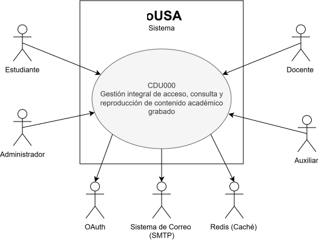

### Primera Descomposición General

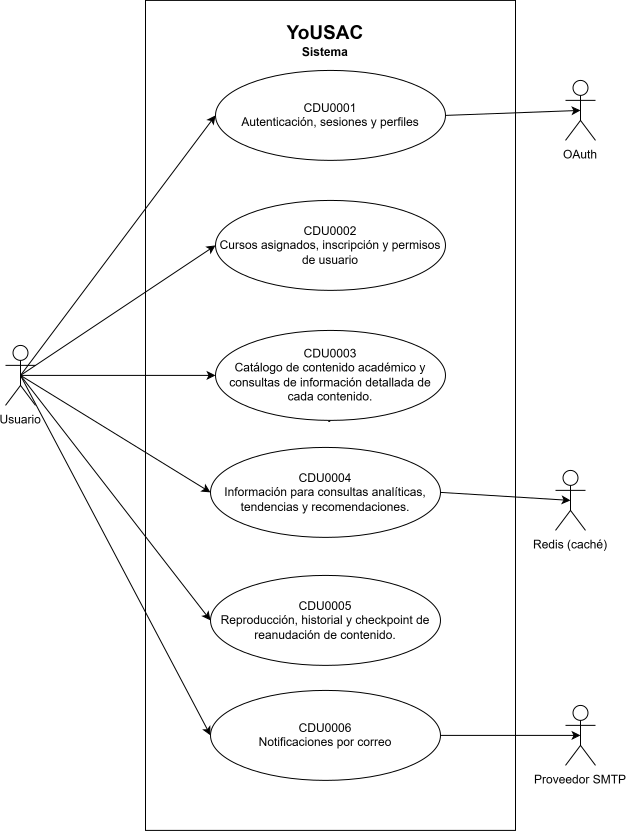

### Primera Descomposición por módulo
#### Módulo de Autenticación
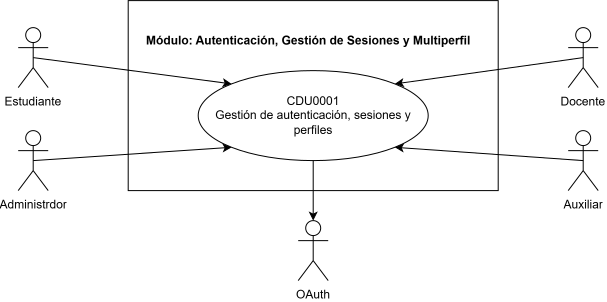

#### Módulo de Inscripciones
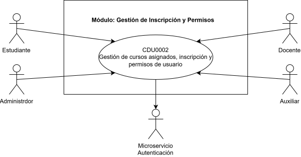

#### Módulo de Contenido
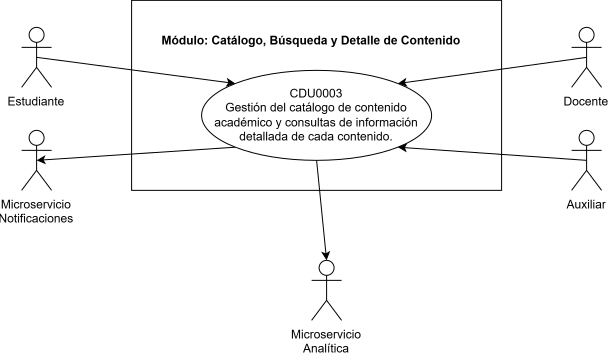

#### Módulo de Métricas
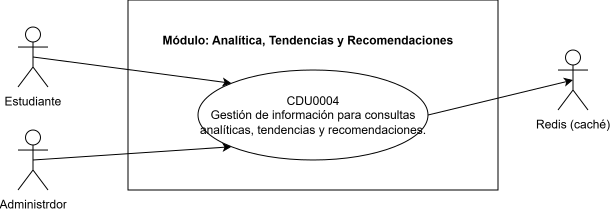

#### Módulo de Reproducción
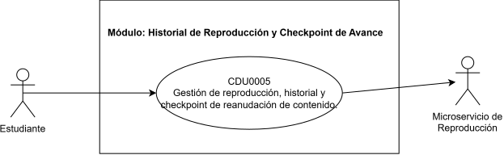

#### Módulo de Notificaciones
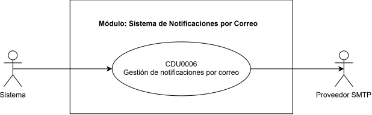

# Casos de uso expandidos
## Módulo 1: Autenticación, Gestión de Sesiones y Multiperfil

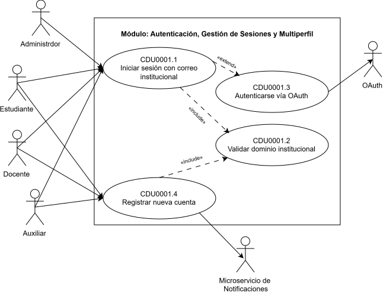
---

### CDU0001.1: Autenticar usuario institucional
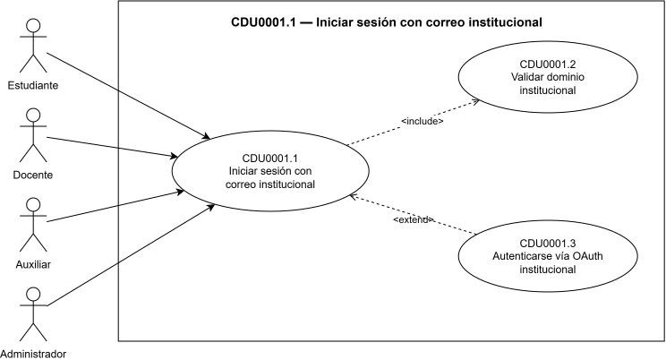

| Campo | Descripción |
|-------|-------------|
| ID | CDU0001.1 |
| Nombre | Iniciar sesión con correo institucional |
| Actor | Estudiante, Docente, Auxiliar, Administrador |
| Descripción | Permite a usuarios con correo institucional autenticarse en la plataforma, estableciendo una sesión segura. |
| Precondiciones | El usuario ya debe tener una cuenta registrada. |
| Postcondiciones | El usuario tiene una sesión activa con su rol identificado. |

**Flujo principal:**

| Paso | Actor | Acción |
|------|-------|--------|
| 1 | Usuario | Accede a la pantalla de login. |
| 2 | Usuario | Ingresa correo institucional y contraseña. |
| 3 | Sistema | Validar que se tenga un dominio institucional. |
| 4 | Sistema | Valida las credenciales contra la base de datos. |
| 5 | Sistema | Genera un JWT y una Session Cookie. |
| 6 | Sistema | Redirige al usuario al catálogo principal según su rol. |

**Flujos alternativos:**

| ID | Condición | Acción |
|----|-----------|--------|
| FA-01 | El usuario elige ingresar con cuenta institucional usando el servicio OAuth | El sistema extiende hace la validación con el proveedor y se sigue el flujo principal desde el paso 5. |

**Flujos de excepción:**

| ID | Condición | Acción |
|----|-----------|--------|
| FE-01 | El correo no pertenece al dominio institucional | El sistema rechaza el intento y muestra "Correo no autorizado". |
| FE-02 | La contraseña no coincide | El sistema incrementa el contador de intentos fallidos y muestra "Credenciales incorrectas". |

---

### CDU0001.2: Validar dominio institucional

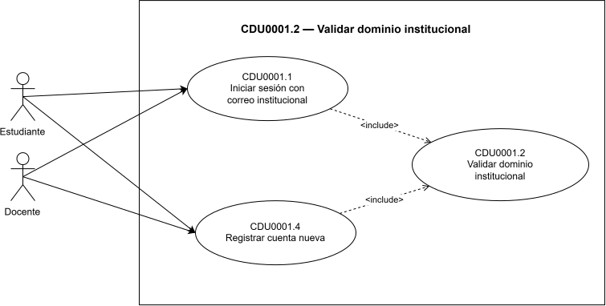

| Campo | Descripción |
|-------|-------------|
| ID | CDU0001.2 |
| Nombre | Validar dominio institucional |
| Actor | include |
| Descripción | Verifica que el correo ingresado pertenezca al dominio autorizado de la Facultad de Ingeniería. |
| Precondiciones | Se recibió un correo electrónico como parte de un login o registro. |
| Postcondiciones | Se confirma o rechaza la validez del dominio del correo. |

**Flujo principal:**

| Paso | Actor | Acción |
|------|-------|--------|
| 1 | Sistema | Recibe el correo electrónico a validar. |
| 2 | Sistema | Compara el dominio permitido con el ingresado. |
| 3 | Sistema | Retorna "dominio válido" al caso de uso que lo invocó. |

**Flujos alternativos:**

| ID | Condición | Acción |
|----|-----------|--------|
| - | - | - |

**Flujos de excepción:**

| ID | Condición | Acción |
|----|-----------|--------|
| FE-01 | El dominio no está autorizado | El sistema retorna "dominio inválido" y el caso de uso invocador aborta el flujo. |

---

### CDU0001.3: Autenticarse vía OAuth institucional

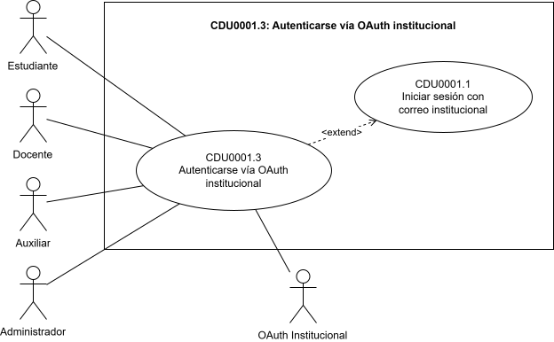

| Campo | Descripción |
|-------|-------------|
| ID | CDU0001.3 |
| Nombre | Autenticarse vía OAuth institucional |
| Actor | Estudiante, Docente, Auxiliar, Administrador, OAuth Institucional |
| Descripción | Ruta alternativa (extend) de autenticación delegando la verificación de identidad al proveedor OAuth institucional. |
| Precondiciones | El usuario cuenta con una identidad federada en el sistema OAuth de la universidad. |
| Postcondiciones | El usuario queda autenticado mediante identidad federada. |

**Flujo principal:**

| Paso | Actor | Acción |
|------|-------|--------|
| 1 | Usuario | Selecciona "Ingresar con cuenta institucional" en el login. |
| 2 | Sistema | Redirige al usuario al proveedor OAuth institucional. |
| 3 | Usuario | Se autentica en el proveedor OAuth. |
| 4 | OAuth Institucional | Retorna un token de identidad al sistema. |
| 5 | Sistema | Valida el token y continúa el flujo de principal desde su paso 5. |

**Flujos alternativos:**

| ID | Condición | Acción |
|----|-----------|--------|
| - | - | - |

**Flujos de excepción:**

| ID | Condición | Acción |
|----|-----------|--------|
| FE-01 | El usuario cancela o falla la autenticación en el proveedor | El sistema retorna al login mostrando "No se pudo completar el inicio de sesión". |
| FE-02 | El token recibido es inválido o expiró | El sistema rechaza el intento y solicita reintentar. |

---

### CDU0001.4: Registrar cuenta nueva

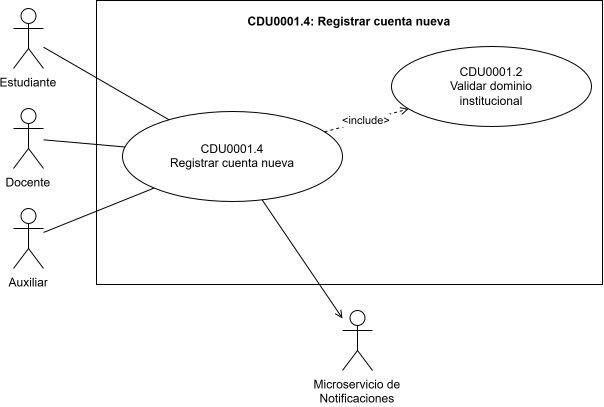

| Campo | Descripción |
|-------|-------------|
| ID | CDU0001.4 |
| Nombre | Registrar cuenta nueva |
| Actor | Estudiante, Docente/Catedrático, Auxiliar, Microservicio de Notificaciones |
| Descripción | Permite a un usuario con correo institucional crear su cuenta por primera vez en la plataforma. |
| Precondiciones | El usuario no tiene una cuenta previamente creada. |
| Postcondiciones | Se crea una nueva cuenta de usuario y se notifica por correo. |

**Flujo principal:**

| Paso | Actor | Acción |
|------|-------|--------|
| 1 | Usuario | Accede a la pantalla de registro. |
| 2 | Usuario | Ingresa su correo institucional y define una contraseña. |
| 3 | Sistema | Ejecuta CDU0001.2 (Validar dominio institucional). |
| 4 | Sistema | Crea el registro de usuario con rol por defecto (Estudiante). |
| 5 | Sistema | Dispara un evento hacia el Microservicio de Notificaciones para enviar el correo de confirmación de registro. |
| 6 | Sistema | Redirige al usuario al login. |

**Flujos alternativos:**

| ID | Condición | Acción |
|----|-----------|--------|
| - | - | - |

**Flujos de excepción:**

| ID | Condición | Acción |
|----|-----------|--------|
| FE-01 | El correo no pertenece al dominio institucional | El registro se rechaza mostrando "Correo no autorizado". |
| FE-02 | El correo ya está registrado | El sistema muestra "Ya existe una cuenta con este correo" y sugiere iniciar sesión. |

---
## Módulo 2: Gestión de Inscripción y Permisos

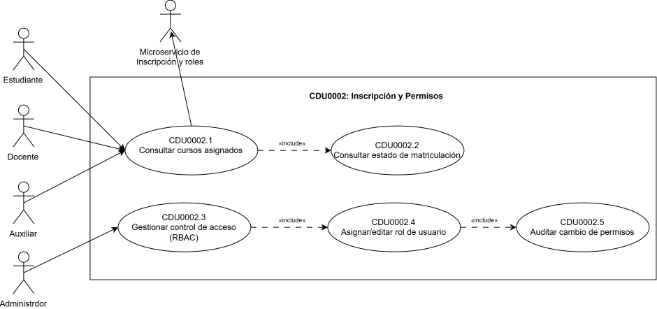

---

### CDU0002.1: Consultar cursos asignados/inscritos

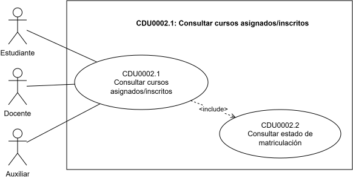

| Campo | Descripción |
|-------|-------------|
| ID | CDU0002.1 |
| Nombre | Consultar cursos asignados/inscritos |
| Actor | Estudiante, Docente/Catedrático, Auxiliar |
| Descripción | Permite a cualquier usuario institucional consultar los cursos en los que está inscrito o asignado durante el semestre vigente. |
| Precondiciones | El usuario tiene una sesión activa. |
| Postcondiciones | Se muestra al usuario el listado de cursos correspondiente a su rol. |

Flujo principal:

| Paso | Actor | Acción |
|------|-------|--------|
| 1 | Usuario | Accede al panel de cursos/asignaciones. |
| 2 | Sistema | Identifica el rol del usuario mediante el Microservicio de Autenticación. |
| 3 | Sistema | Ejecuta consultar estado de matriculación. |
| 4 | Sistema | Muestra el listado de cursos según el rol. |

Flujos alternativos:

| ID | Condición | Acción |
|----|-----------|--------|
| - | - | - |

Flujos de excepción:

| ID | Condición | Acción |
|----|-----------|--------|
| FE-01 | El usuario no tiene cursos registrados para el semestre vigente | El sistema muestra "No hay cursos asociados a tu cuenta este semestre". |
| FE-02 | Error de comunicación con el Microservicio de Autenticación | El sistema muestra un mensaje de error genérico y solicita reintentar. |

---

### CDU0002.2: Consultar estado de matriculación

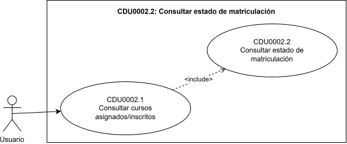

| Campo | Descripción |
|-------|-------------|
| ID | CDU0002.2 |
| Nombre | Consultar estado de matriculación |
| Actor | include |
| Descripción | Verifica y retorna el estado de matriculación vigente del usuario (activo, pendiente, cerrado). |
| Precondiciones | El usuario ya fue identificado por rol. |
| Postcondiciones | Se retorna el estado de matriculación al caso de uso que lo invocó. |

Flujo principal:

| Paso | Actor | Acción |
|------|-------|--------|
| 1 | Sistema | Consulta la base de datos de matriculación del usuario. |
| 2 | Sistema | Retorna el estado vigente. |

Flujos alternativos:

| ID | Condición | Acción |
|----|-----------|--------|
| — | Ninguno | — |

Flujos de excepción:

| ID | Condición | Acción |
|----|-----------|--------|
| FE-01 | No existe registro de matriculación | El sistema retorna "sin matrícula" al caso de uso invocador. |

---

### CDU0002.3: Gestionar control de acceso por roles (RBAC)

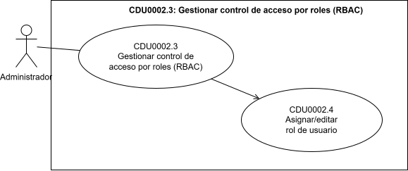

| Campo | Descripción |
|-------|-------------|
| ID | CDU0002.3 |
| Nombre | Gestionar control de acceso por roles (RBAC) |
| Actor | Administrador |
| Descripción | Permite al administrador visualizar y administrar los roles existentes en la plataforma (Estudiante, Docente/Catedrático, Auxiliar, Administrador). |
| Precondiciones | El administrador tiene una sesión activa. |
| Postcondiciones | El administrador puede ver y gestionar los roles del sistema. |

Flujo principal:

| Paso | Actor | Acción |
|------|-------|--------|
| 1 | Administrador | Accede al panel de gestión de roles. |
| 2 | Sistema | Muestra el listado de usuarios con su rol actual. |
| 3 | Administrador | Selecciona un usuario para modificar su rol. |
| 4 | Sistema | Ejecuta asignar/editar rol de usuario. |

Flujos alternativos:

| ID | Condición | Acción |
|----|-----------|--------|
| - | - | - |

Flujos de excepción:

| ID | Condición | Acción |
|----|-----------|--------|
| FE-01 | El administrador no tiene permisos suficientes | El sistema muestra "Acceso denegado". |

---

### CDU0002.4: Asignar/editar rol de usuario

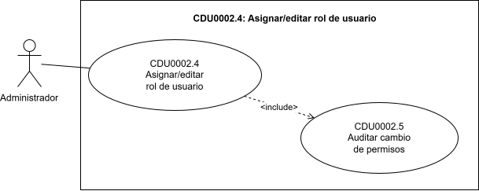

| Campo | Descripción |
|-------|-------------|
| ID | CDU0002.4 |
| Nombre | Asignar/editar rol de usuario |
| Actor | Administrador |
| Descripción | Permite modificar el rol asignado a un usuario específico dentro del sistema. |
| Precondiciones | El usuario a modificar existe en el sistema. |
| Postcondiciones | El rol del usuario queda actualizado. |

Flujo principal:

| Paso | Actor | Acción |
|------|-------|--------|
| 1 | Administrador | Selecciona el nuevo rol para el usuario. |
| 2 | Sistema | Actualiza el rol del usuario en la base de datos. |
| 3 | Sistema | Ejecuta auditar cambio de permisos. |
| 4 | Sistema | Confirma el cambio al administrador. |

Flujos alternativos:

| ID | Condición | Acción |
|----|-----------|--------|
| - | - | - |

Flujos de excepción:

| ID | Condición | Acción |
|----|-----------|--------|
| FE-01 | El rol seleccionado no es válido | El sistema rechaza el cambio y muestra "Rol inválido". |

---

### CDU0002.5: Auditar cambio de permisos

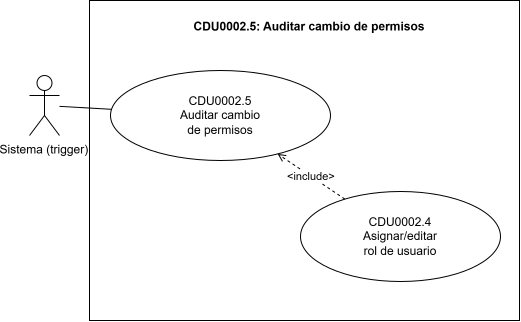

| Campo | Descripción |
|-------|-------------|
| ID | CDU0002.5 |
| Nombre | Auditar cambio de permisos |
| Actor | ejecutado automáticamente como trigger de base de datos |
| Descripción | Registra en la bitácora de auditoría cada cambio de rol/permiso realizado sobre un usuario. |
| Precondiciones | Se realizó un cambio de rol. |
| Postcondiciones | Queda un registro de auditoría del cambio. |

Flujo principal:

| Paso | Actor | Acción |
|------|-------|--------|
| 1 | Sistema (trigger) | Detecta el cambio de rol en la base de datos. |
| 2 | Sistema (trigger) | Inserta un registro de auditoría con el detalle del cambio. |

Flujos alternativos:

| ID | Condición | Acción |
|----|-----------|--------|
| - | - | - |

Flujos de excepción:

| ID | Condición | Acción |
|----|-----------|--------|
| FE-01 | Falla la escritura del registro de auditoría | El sistema revierte el cambio de rol y notifica el error al administrador. |

---
## Módulo 3: Catálogo, Búsqueda y Detalle de Contenido

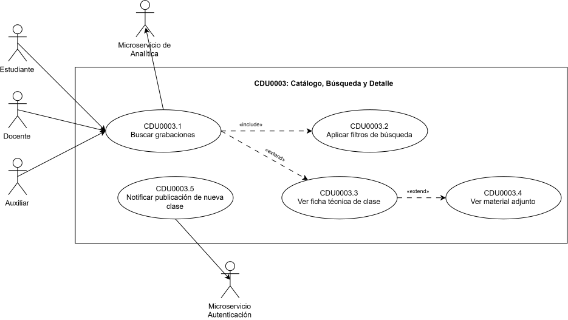
---

### CDU0003.1: Buscar grabaciones

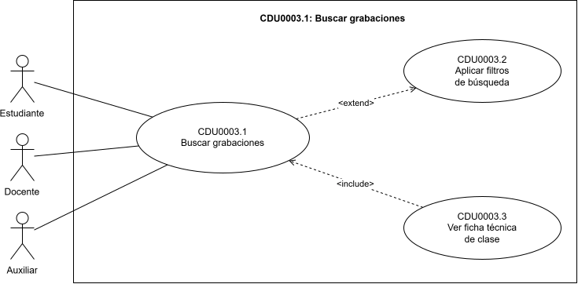

| Campo | Descripción |
|-------|-------------|
| ID | CDU0003.1 |
| Nombre | Buscar grabaciones |
| Actor | Estudiante, Docente, Auxiliar |
| Descripción | Permite a cualquier usuario institucional buscar grabaciones de clases dentro del catálogo académico. |
| Precondiciones | El usuario tiene una sesión activa. |
| Postcondiciones | Se muestra al usuario el listado de grabaciones que coinciden con la búsqueda. |

Flujo principal:

| Paso | Actor | Acción |
|------|-------|--------|
| 1 | Usuario | Accede al catálogo de grabaciones. |
| 2 | Usuario | Ingresa un término de búsqueda o abre el panel de filtros. |
| 3 | Sistema | Ejecuta aplicar filtros de búsqueda. |
| 4 | Sistema | Muestra el listado de resultados. |

Flujos alternativos:

| ID | Condición | Acción |
|----|-----------|--------|
| FA-01 | El usuario selecciona un resultado del listado | El sistema extiende hacia ver ficha técnica de clase. |

Flujos de excepción:

| ID | Condición | Acción |
|----|-----------|--------|
| FE-01 | No hay resultados que coincidan con la búsqueda | El sistema muestra "No se encontraron grabaciones para tu búsqueda". |
| FE-02 | Error de comunicación con el catálogo | El sistema muestra un mensaje de error genérico y solicita reintentar. |

---

### CDU0003.2: Aplicar filtros de búsqueda

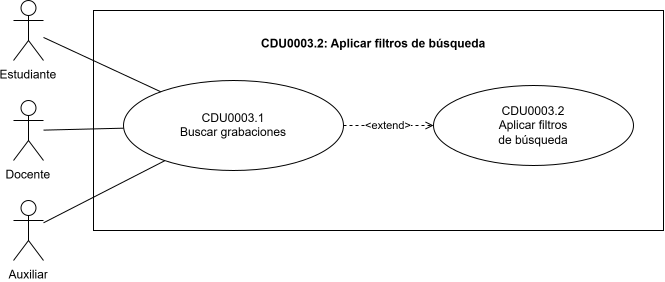

| Campo | Descripción |
|-------|-------------|
| ID | CDU0003.2 |
| Nombre | Aplicar filtros de búsqueda |
| Actor | include |
| Descripción | Filtra las grabaciones del catálogo por semestre/año, escuela/área, curso, catedrático y tema/etiqueta. |
| Precondiciones | Se recibió un criterio de búsqueda o filtro. |
| Postcondiciones | Se retorna el subconjunto de grabaciones que cumple los filtros. |

Flujo principal:

| Paso | Actor | Acción |
|------|-------|--------|
| 1 | Sistema | Recibe los criterios de filtro seleccionados. |
| 2 | Sistema | Consulta la base de datos del catálogo aplicando los filtros. |
| 3 | Sistema | Retorna el listado filtrado al caso de uso invocador. |

Flujos alternativos:

| ID | Condición | Acción |
|----|-----------|--------|
| - | - | - |

Flujos de excepción:

| ID | Condición | Acción |
|----|-----------|--------|
| FE-01 | Combinación de filtros inválida  | El sistema ignora el filtro inválido y aplica el resto. |

---

### CDU0003.3: Ver ficha técnica de clase

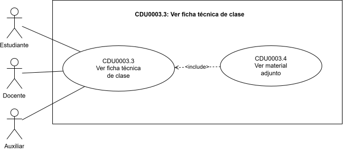

| Campo | Descripción |
|-------|-------------|
| ID | CDU0003.3 |
| Nombre | Ver ficha técnica de clase |
| Actor | Estudiante, Docente, Auxiliar |
| Descripción | Muestra el detalle de una grabación: unidad del programa, fecha de impartición, catedráticos/auxiliares participantes. |
| Precondiciones | El usuario seleccionó una grabación. |
| Postcondiciones | Se muestra la ficha técnica completa de la clase. |

Flujo principal:

| Paso | Actor | Acción |
|------|-------|--------|
| 1 | Usuario | Selecciona una grabación del listado de resultados. |
| 2 | Sistema | Consulta los datos de la ficha técnica de la clase. |
| 3 | Sistema | Muestra la ficha técnica al usuario. |

Flujos alternativos:

| ID | Condición | Acción |
|----|-----------|--------|
| FA-01 | La clase tiene material adjunto | El sistema extiende hacia ver material adjunto. |

Flujos de excepción:

| ID | Condición | Acción |
|----|-----------|--------|
| FE-01 | La grabación ya no está disponible | El sistema muestra "Esta grabación ya no se encuentra disponible". |

---

### CDU0003.4: Ver material adjunto

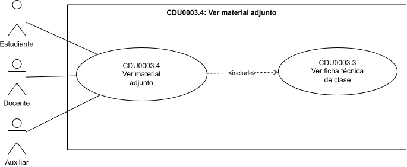

| Campo | Descripción |
|-------|-------------|
| ID | CDU0003.4 |
| Nombre | Ver material adjunto |
| Actor | Estudiante, Docente, Auxiliar |
| Descripción | Permite consultar y descargar el material adjunto asociado a una clase grabada. |
| Precondiciones | La ficha técnica de la clase tiene material adjunto disponible. |
| Postcondiciones | El usuario visualiza o descarga el material adjunto. |

Flujo principal:

| Paso | Actor | Acción |
|------|-------|--------|
| 1 | Usuario | Selecciona el material adjunto desde la ficha técnica. |
| 2 | Sistema | Recupera el archivo asociado. |
| 3 | Sistema | Muestra o descarga el archivo al usuario. |

Flujos alternativos:

| ID | Condición | Acción |
|----|-----------|--------|
| - | - | - |

Flujos de excepción:

| ID | Condición | Acción |
|----|-----------|--------|
| FE-01 | El archivo no se pudo recuperar | El sistema muestra "No se pudo cargar el material adjunto". |

---

### CDU0003.5: Notificar publicación de nueva clase

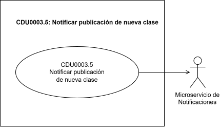

| Campo | Descripción |
|-------|-------------|
| ID | CDU0003.5 |
| Nombre | Notificar publicación de nueva clase |
| Actor | Microservicio de Notificaciones |
| Descripción | Cuando se agrega una nueva grabación al catálogo, dispara un evento hacia el Microservicio de Notificaciones para avisar a los estudiantes inscritos en el curso correspondiente. |
| Precondiciones | Se publicó una nueva grabación en el catálogo. |
| Postcondiciones | Los estudiantes inscritos reciben la notificación de la nueva clase disponible. |

Flujo principal:

| Paso | Actor | Acción |
|------|-------|--------|
| 1 | Sistema | Detecta la publicación de una nueva grabación en el catálogo. |
| 2 | Sistema | Identifica a los estudiantes inscritos en el curso correspondiente. |
| 3 | Sistema | Dispara el evento hacia el Microservicio de Notificaciones. |

Flujos alternativos:

| ID | Condición | Acción |
|----|-----------|--------|
| - | - | - |

Flujos de excepción:

| ID | Condición | Acción |
|----|-----------|--------|
| FE-01 | Falla la comunicación con el Microservicio de Notificaciones | El sistema registra el evento en una cola de reintentos. |

---

## Módulo 4: Analítica, Tendencias y Recomendaciones

 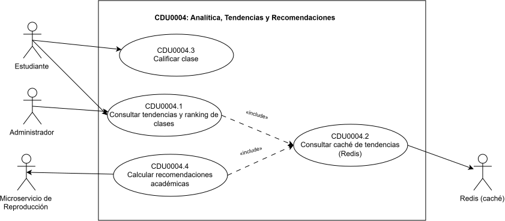

---
 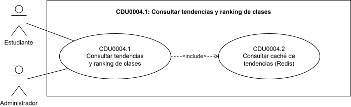

| Campo | Descripción |
|-------|-------------|
| ID | CDU0004.1 |
| Nombre | Consultar tendencias y ranking de clases |
| Actor | Estudiante, Administrador |
| Descripción | Permite consultar las clases más vistas por semana, los temas de mayor tendencia y el ranking de clases mejor valoradas. |
| Precondiciones | El usuario tiene una sesión activa. |
| Postcondiciones | Se muestra al usuario el listado de tendencias y ranking vigente. |

Flujo principal:

| Paso | Actor | Acción |
|------|-------|--------|
| 1 | Usuario | Accede a la sección de tendencias. |
| 2 | Sistema | Ejecuta consultar caché de tendencias (Redis). |
| 3 | Sistema | Muestra el ranking y las tendencias vigentes. |

Flujos alternativos:

| ID | Condición | Acción |
|----|-----------|--------|
| - | - | - |

Flujos de excepción:

| ID | Condición | Acción |
|----|-----------|--------|
| FE-01 | La caché no tiene datos vigentes  | El sistema recalcula las tendencias desde la base de datos y actualiza la caché. |
| FE-02 | Error de comunicación con Redis | El sistema muestra un mensaje de error genérico y solicita reintentar. |

---
 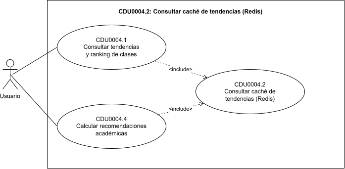

| Campo | Descripción |
|-------|-------------|
| ID | CDU0004.2 |
| Nombre | Consultar caché de tendencias (Redis) |
| Actor | include |
| Descripción | Recupera desde Redis las consultas frecuentes de catálogo y tendencias, evitando sobrecargar la base de datos. |
| Precondiciones | Se solicitó una consulta de tendencias o recomendaciones. |
| Postcondiciones | Se retorna el dato solicitado desde la caché o se señala que expiró. |

Flujo principal:

| Paso | Actor | Acción |
|------|-------|--------|
| 1 | Sistema | Consulta la clave correspondiente en Redis. |
| 2 | Sistema | Retorna el valor cacheado al caso de uso invocador. |

Flujos alternativos:

| ID | Condición | Acción |
|----|-----------|--------|
| - | - | - |

Flujos de excepción:

| ID | Condición | Acción |
|----|-----------|--------|
| FE-01 | La clave no existe o expiró| El sistema retorna "caché vacía" al caso de uso invocador. |

---

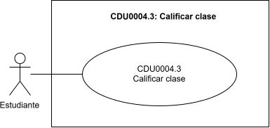

| Campo | Descripción |
|-------|-------------|
| ID | CDU0004.3 |
| Nombre | Calificar clase |
| Actor | Estudiante |
| Descripción | Permite a un estudiante calificar una clase vista, alimentando el cálculo dinámico del ranking y las recomendaciones. |
| Precondiciones | El estudiante consultó la ficha técnica de la clase. |
| Postcondiciones | Se registra la calificación y se actualiza el porcentaje de recomendación de la clase. |

Flujo principal:

| Paso | Actor | Acción |
|------|-------|--------|
| 1 | Usuario | Selecciona una puntuación desde la ficha técnica de la clase. |
| 2 | Sistema | Registra la calificación en la base de datos. |
| 3 | Sistema | Recalcula el porcentaje de recomendación de la clase. |

Flujos alternativos:

| ID | Condición | Acción |
|----|-----------|--------|
| FA-01 | El estudiante ya había calificado la clase | El sistema actualiza la calificación previa en lugar de crear una nueva. |

Flujos de excepción:

| ID | Condición | Acción |
|----|-----------|--------|
| FE-01 | Error al registrar la calificación | El sistema muestra un mensaje de error genérico y solicita reintentar. |

---

 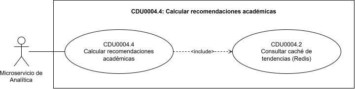

| Campo | Descripción |
|-------|-------------|
| ID | CDU0004.4 |
| Nombre | Calcular recomendaciones académicas |
| Actor | Microservicio de Reproducción |
| Descripción | Calcula dinámicamente un porcentaje de recomendación para cada clase, a partir del historial de reproducción y las calificaciones registradas. |
| Precondiciones | Existen datos de reproducción y/o calificaciones disponibles. |
| Postcondiciones | Se actualiza el porcentaje de recomendación de las clases procesadas. |

Flujo principal:

| Paso | Actor | Acción |
|------|-------|--------|
| 1 | Sistema | Recibe los datos de reproducción/checkpoint desde el microservicio de historial. |
| 2 | Sistema | Ejecuta consultar caché de tendencias (Redis). |
| 3 | Sistema | Calcula el porcentaje de recomendación de cada clase. |
| 4 | Sistema | Actualiza los resultados en la base de datos y en la caché. |

Flujos alternativos:

| ID | Condición | Acción |
|----|-----------|--------|
| - | - | - |

Flujos de excepción:

| ID | Condición | Acción |
|----|-----------|--------|
| FE-01 | No hay suficientes datos históricos para calcular la recomendación | El sistema asigna un valor por defecto y marca la clase como "sin suficiente información". |

---

## Módulo 5: Historial de Reproducción y Checkpoint de Avance

 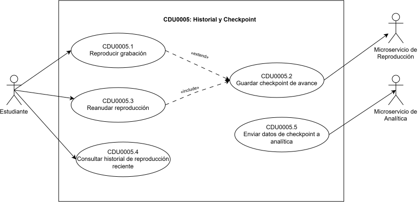

---

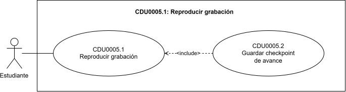

| Campo | Descripción |
|-------|-------------|
| ID | CDU0005.1 |
| Nombre | Reproducir grabación |
| Actor | Estudiante |
| Descripción | Permite al estudiante reproducir el video de una clase grabada. |
| Precondiciones | El estudiante tiene una sesión activa. |
| Postcondiciones | El video se reproduce y el sistema comienza a registrar el avance. |

Flujo principal:

| Paso | Actor | Acción |
|------|-------|--------|
| 1 | Usuario | Selecciona una grabación desde su ficha técnica. |
| 2 | Sistema | Carga el video y comienza la reproducción. |
| 3 | Sistema | Registra periódicamente el minuto exacto de avance. |

Flujos alternativos:

| ID | Condición | Acción |
|----|-----------|--------|
| FA-01 | El estudiante pausa o cierra el video antes de terminar | El sistema extiende hacia guardar checkpoint de avance. |

Flujos de excepción:

| ID | Condición | Acción |
|----|-----------|--------|
| FE-01 | El video no se puede cargar | El sistema muestra "No se pudo cargar la grabación" y solicita reintentar. |

---

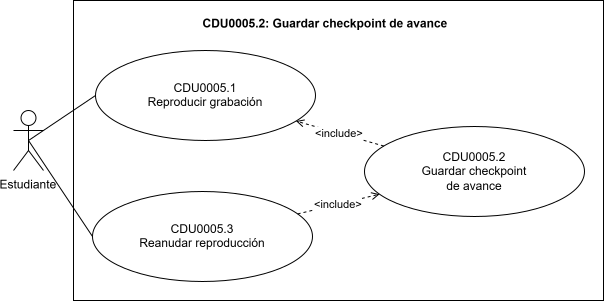

| Campo | Descripción |
|-------|-------------|
| ID | CDU0005.2 |
| Nombre | Guardar checkpoint de avance |
| Actor | include |
| Descripción | Almacena con precisión el semestre, curso, unidad, tema y segundo/minuto exacto donde el estudiante detuvo la reproducción. |
| Precondiciones | El estudiante estaba reproduciendo una grabación. |
| Postcondiciones | Queda registrado el punto exacto de avance para esa clase y ese estudiante. |

Flujo principal:

| Paso | Actor | Acción |
|------|-------|--------|
| 1 | Sistema | Captura el punto exacto de reproducción. |
| 2 | Sistema | Almacena o actualiza el checkpoint asociado a la cuenta del estudiante. |

Flujos alternativos:

| ID | Condición | Acción |
|----|-----------|--------|
| - | - | - |

Flujos de excepción:

| ID | Condición | Acción |
|----|-----------|--------|
| FE-01 | Falla el guardado del checkpoint | El sistema reintenta en segundo plano sin interrumpir al usuario. |

---

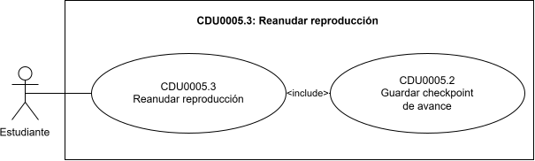

| Campo | Descripción |
|-------|-------------|
| ID | CDU0005.3 |
| Nombre | Reanudar reproducción |
| Actor | Estudiante |
| Descripción | Permite al estudiante continuar viendo una clase exactamente desde el punto donde la dejó. |
| Precondiciones | Existe un checkpoint previo guardado para esa clase y ese estudiante. |
| Postcondiciones | El video se reanuda desde el minuto exacto del checkpoint. |

Flujo principal:

| Paso | Actor | Acción |
|------|-------|--------|
| 1 | Usuario | Selecciona una clase que ya había visto parcialmente. |
| 2 | Sistema | Ejecuta guardar checkpoint de avance para recuperar el último punto guardado. |
| 3 | Sistema | Reanuda la reproducción desde ese punto. |

Flujos alternativos:

| ID | Condición | Acción |
|----|-----------|--------|
| - | - | - |

Flujos de excepción:

| ID | Condición | Acción |
|----|-----------|--------|
| FE-01 | No existe checkpoint previo para esa clase | El sistema inicia la reproducción desde el minuto 0. |

---

 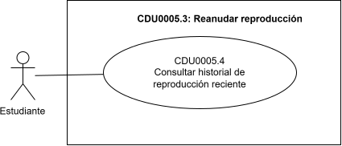

| Campo | Descripción |
|-------|-------------|
| ID | CDU0005.4 |
| Nombre | Consultar historial de reproducción reciente |
| Actor | Estudiante |
| Descripción | Muestra al estudiante el listado de clases vistas recientemente y su avance en cada una. |
| Precondiciones | El estudiante tiene una sesión activa. |
| Postcondiciones | Se muestra el historial reciente con el progreso de cada clase. |

Flujo principal:

| Paso | Actor | Acción |
|------|-------|--------|
| 1 | Usuario | Accede a la sección de historial reciente. |
| 2 | Sistema | Consulta los checkpoints más recientes del estudiante. |
| 3 | Sistema | Muestra el listado con el porcentaje de avance de cada clase. |

Flujos alternativos:

| ID | Condición | Acción |
|----|-----------|--------|
| - | - | - |

Flujos de excepción:

| ID | Condición | Acción |
|----|-----------|--------|
| FE-01 | El estudiante no tiene historial reciente | El sistema muestra "Aún no has visto ninguna clase". |

---

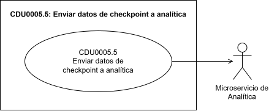

| Campo | Descripción |
|-------|-------------|
| ID | CDU0005.5 |
| Nombre | Enviar datos de checkpoint a analítica |
| Actor | Microservicio de Analítica |
| Descripción | Envía de forma periódica los datos de reproducción y checkpoints hacia el módulo de Analítica para el cálculo de tendencias y recomendaciones. |
| Precondiciones | Existen checkpoints nuevos o actualizados desde la última sincronización. |
| Postcondiciones | El Microservicio de Analítica recibe los datos actualizados de reproducción. |

Flujo principal:

| Paso | Actor | Acción |
|------|-------|--------|
| 1 | Sistema | Identifica los checkpoints nuevos o actualizados. |
| 2 | Sistema | Envía el lote de datos hacia el Microservicio de Analítica. |

Flujos alternativos:

| ID | Condición | Acción |
|----|-----------|--------|
| - | - | - |

Flujos de excepción:

| ID | Condición | Acción |
|----|-----------|--------|
| FE-01 | Falla la comunicación con el Microservicio de Analítica | El sistema encola el envío para reintentarlo más tarde. |

---

## Módulo 6: Sistema de Notificaciones por Correo

  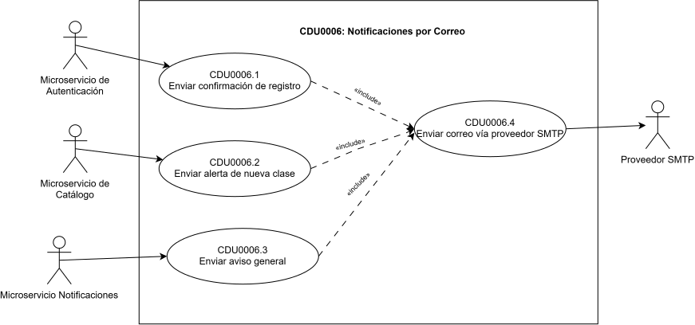

---

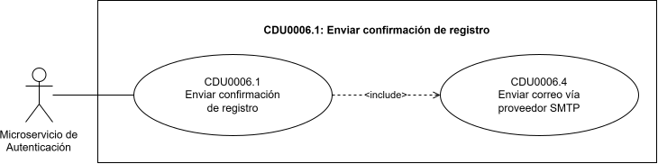

| Campo | Descripción |
|-------|-------------|
| ID | CDU0006.1 |
| Nombre | Enviar confirmación de registro |
| Actor | Microservicio de Autenticación |
| Descripción | Envía un correo de confirmación cuando un usuario completa su registro en la plataforma. |
| Precondiciones | Se creó una cuenta nueva. |
| Postcondiciones | El usuario recibe el correo de confirmación de registro. |

Flujo principal:

| Paso | Actor | Acción |
|------|-------|--------|
| 1 | Sistema | Recibe el evento de registro exitoso. |
| 2 | Sistema | Genera el contenido del correo de confirmación. |
| 3 | Sistema | Ejecuta enviar correo vía proveedor SMTP. |

Flujos alternativos:

| ID | Condición | Acción |
|----|-----------|--------|
| - | - | - |

Flujos de excepción:

| ID | Condición | Acción |
|----|-----------|--------|
| FE-01 | El evento de registro llega incompleto  | El sistema descarta la notificación y registra el error. |

---

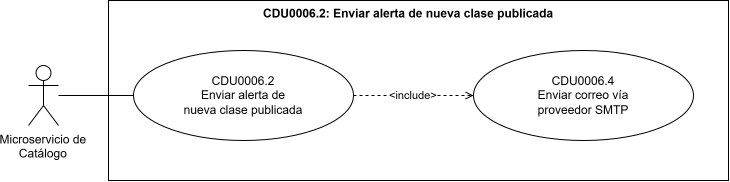

| Campo | Descripción |
|-------|-------------|
| ID | CDU0006.2 |
| Nombre | Enviar alerta de nueva clase publicada |
| Actor | Microservicio de Catálogo |
| Descripción | Notifica a los estudiantes inscritos en un curso cuando se publica una nueva grabación de clase. |
| Precondiciones | Se publicó una grabación nueva en el catálogo. |
| Postcondiciones | Los estudiantes inscritos reciben el correo de alerta. |

Flujo principal:

| Paso | Actor | Acción |
|------|-------|--------|
| 1 | Sistema | Recibe el evento de publicación de nueva clase. |
| 2 | Sistema | Genera el contenido del correo de alerta con los datos de la clase. |
| 3 | Sistema | Ejecuta enviar correo vía proveedor SMTP para cada destinatario. |

Flujos alternativos:

| ID | Condición | Acción |
|----|-----------|--------|
| - | - | - |

Flujos de excepción:

| ID | Condición | Acción |
|----|-----------|--------|
| FE-01 | No hay estudiantes inscritos en el curso | El sistema descarta el envío sin generar correos. |

---

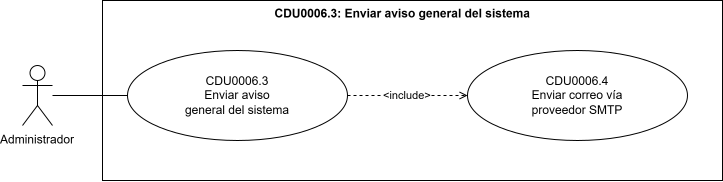

| Campo | Descripción |
|-------|-------------|
| ID | CDU0006.3 |
| Nombre | Enviar aviso general del sistema |
| Actor | Administrador |
| Descripción | Permite al administrador enviar un aviso general a todos los usuarios o a un grupo específico. |
| Precondiciones | El administrador tiene una sesión activa. |
| Postcondiciones | Los destinatarios seleccionados reciben el correo de aviso. |

Flujo principal:

| Paso | Actor | Acción |
|------|-------|--------|
| 1 | Administrador | Redacta el aviso y selecciona los destinatarios. |
| 2 | Sistema | Genera el contenido del correo de aviso. |
| 3 | Sistema | Ejecuta enviar correo vía proveedor SMTP para cada destinatario. |

Flujos alternativos:

| ID | Condición | Acción |
|----|-----------|--------|
| - | - | - |

Flujos de excepción:

| ID | Condición | Acción |
|----|-----------|--------|
| FE-01 | No se seleccionó ningún destinatario | El sistema rechaza el envío y muestra "Selecciona al menos un destinatario". |

---

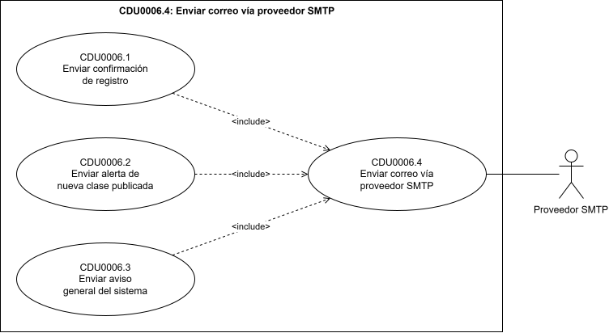

| Campo | Descripción |
|-------|-------------|
| ID | CDU0006.4 |
| Nombre | Enviar correo vía proveedor SMTP |
| Actor | Proveedor SMTP |
| Descripción | Envía el correo electrónico ya generado hacia el destinatario final utilizando el proveedor SMTP configurado. |
| Precondiciones | Existe un contenido de correo listo para enviar. |
| Postcondiciones | El correo queda enviado. |

Flujo principal:

| Paso | Actor | Acción |
|------|-------|--------|
| 1 | Sistema | Envía la solicitud al proveedor SMTP. |
| 2 | Proveedor SMTP | Entrega el correo al destinatario. |
| 3 | Sistema | Registra el envío como exitoso. |

Flujos alternativos:

| ID | Condición | Acción |
|----|-----------|--------|
| - | - | - |

Flujos de excepción:

| ID | Condición | Acción |
|----|-----------|--------|
| FE-01 | El proveedor SMTP no responde o rechaza el envío | El sistema encola el correo para reintento posterior. |

---

## Módulo 7: Aprendizaje interactivo y recursos

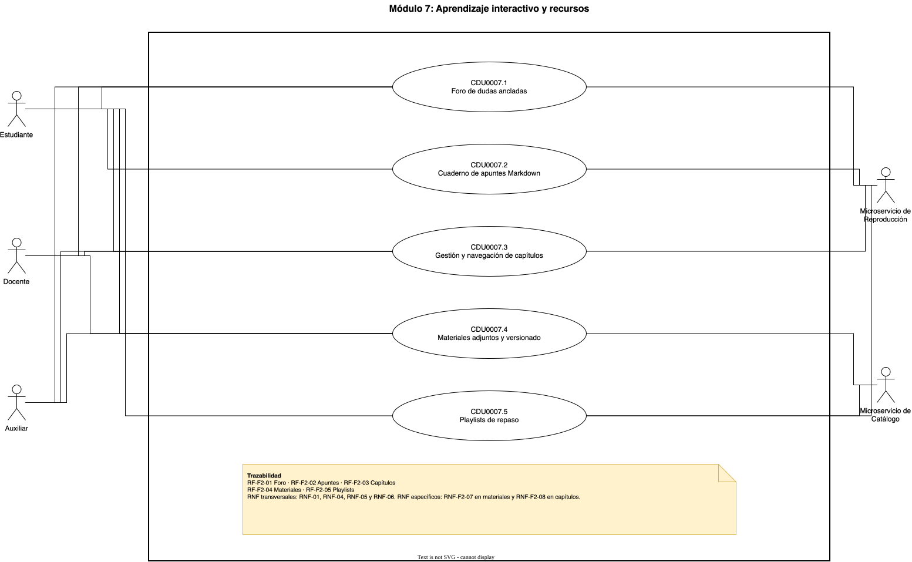

Este módulo reúne las capacidades interactivas y de apoyo al repaso definidas
para Fase 2. Los requisitos funcionales se mantienen como la fuente de
trazabilidad; no se dibujan como casos de uso adicionales. Los RNF-F2-01 a
RNF-F2-06, RNF-F2-09 y RNF-F2-10 se consideran restricciones de infraestructura,
entrega, pruebas y escalabilidad, por lo que tampoco se representan como
óvalos.

| CDU | RF asociado | RNF específico | Estado documentado |
|---|---|---|---|
| CDU0007.1 | RF-F2-01 | RNF-01, RNF-04, RNF-05 y RNF-06 | Diseño objetivo; pendiente/no evidenciado |
| CDU0007.2 | RF-F2-02 | RNF-01, RNF-04, RNF-05 y RNF-06 | Diseño objetivo; pendiente/no evidenciado |
| CDU0007.3 | RF-F2-03 | RNF-F2-08 y RNF-01, RNF-04, RNF-05 y RNF-06 | Integrado; respaldado por código y pruebas |
| CDU0007.4 | RF-F2-04 | RNF-F2-07 y RNF-01, RNF-04, RNF-05 y RNF-06 | Integrado localmente; respaldado por código y pruebas |
| CDU0007.5 | RF-F2-05 | RNF-01, RNF-04, RNF-05 y RNF-06 | Diseño objetivo; pendiente/no evidenciado |

### CDU0007.1: Foro de dudas ancladas

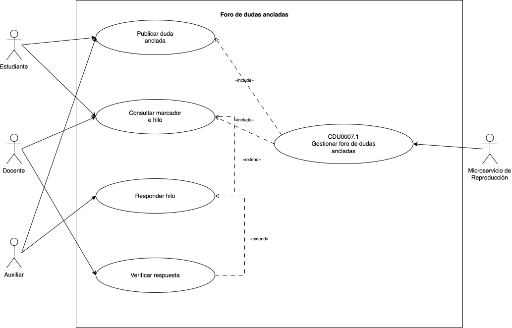

| Campo | Descripción |
|---|---|
| ID | CDU0007.1 |
| RF asociado | RF-F2-01 |
| RNF aplicables | RNF-01, RNF-04, RNF-05 y RNF-06. Los RNF-F2-01 a RNF-F2-06, RNF-F2-09 y RNF-F2-10 se mantienen como restricciones transversales de infraestructura, operación, pruebas y escalabilidad. |
| Estado de implementación | Diseño objetivo; pendiente/no evidenciado. No se encontraron entidades, rutas HTTP, RPC, componentes ni pruebas del foro anclado a timestamps. |
| Nombre | Foro de dudas ancladas |
| Actores | Estudiante, Docente, Auxiliar y Microservicio de Reproducción |
| Descripción | Permite publicar una duda asociada al segundo actual de una grabación, mostrar un marcador sobre la barra de progreso, consultar el hilo, responderlo y marcar una respuesta como verificada. |
| Precondiciones | Existe una clase con duración conocida, el usuario tiene una sesión válida y el segundo seleccionado se encuentra dentro de la duración de la grabación. |
| Postcondiciones | La duda conserva autor, timestamp y estado; el marcador abre el hilo correspondiente y las respuestas quedan asociadas a la duda. |

Flujo principal:

| Paso | Actor | Acción |
|---|---|---|
| 1 | Estudiante | Pausa la grabación y selecciona la opción para publicar una duda. |
| 2 | Sistema | Captura el segundo actual y valida que sea entero, no negativo y menor o igual a la duración de la clase. |
| 3 | Estudiante | Escribe la pregunta y confirma su publicación. |
| 4 | Sistema | Persiste la duda con el autor, la grabación y el timestamp, y muestra el marcador en la barra de progreso. |
| 5 | Estudiante, Docente o Auxiliar | Selecciona el marcador y consulta el hilo de la duda. |
| 6 | Estudiante, Docente o Auxiliar | Publica una respuesta dentro del hilo. |
| 7 | Docente o Auxiliar | Marca una respuesta como correcta o verificada. |

Flujos alternativos:

| ID | Condición | Acción |
|---|---|---|
| FA-01 | Hay varias dudas en el mismo segundo | El sistema agrupa los marcadores o presenta la cantidad y permite abrir cada hilo. |
| FA-02 | La respuesta no requiere verificación | El hilo permanece abierto sin marcar una respuesta como correcta. |
| FA-03 | El usuario reanuda la reproducción desde el marcador | El Microservicio de Reproducción salta al timestamp asociado antes de mostrar el hilo. |

Flujos de excepción:

| ID | Condición | Acción |
|---|---|---|
| FE-01 | El timestamp está fuera de la duración de la clase | El sistema rechaza la duda y solicita seleccionar un segundo válido. |
| FE-02 | La sesión expiró o el usuario no tiene permisos | El sistema solicita autenticarse nuevamente y no guarda la pregunta. |
| FE-03 | Falla la persistencia del hilo | El sistema informa que no pudo publicar la duda, conserva el texto localmente si es posible y permite reintentar. |

### CDU0007.2: Cuaderno de apuntes Markdown

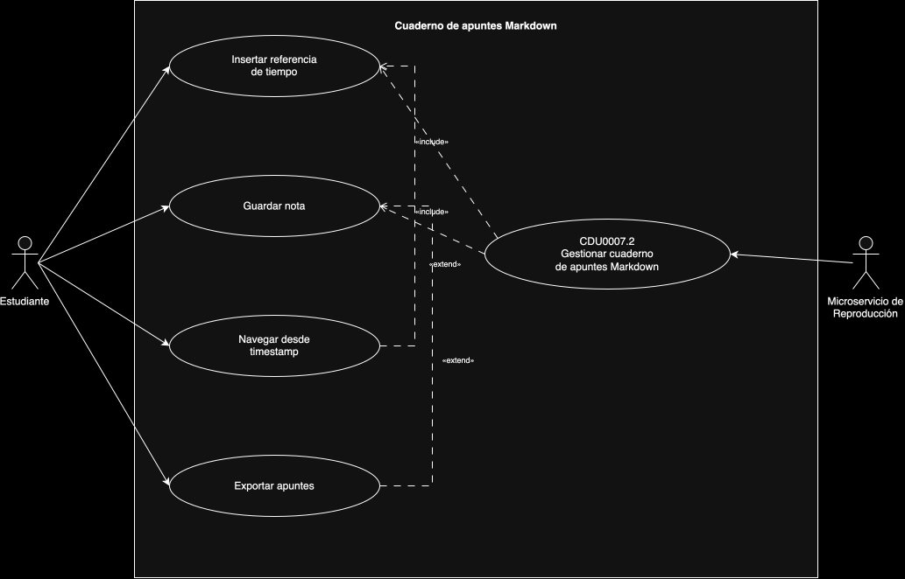

| Campo | Descripción |
|---|---|
| ID | CDU0007.2 |
| RF asociado | RF-F2-02 |
| RNF aplicables | RNF-01, RNF-04, RNF-05 y RNF-06. La disponibilidad, la exportación y la cobertura de pruebas permanecen sujetas a los RNF-F2 correspondientes. |
| Estado de implementación | Diseño objetivo; pendiente/no evidenciado. No se encontraron editor, persistencia de apuntes, navegación por timestamps ni exportación implementados. |
| Nombre | Cuaderno de apuntes Markdown |
| Actores | Estudiante y Microservicio de Reproducción |
| Descripción | Ofrece un cuaderno asociado al perfil del estudiante para redactar apuntes con encabezados, listas, bloques de código y fórmulas LaTeX, insertar referencias como `[18:45]` y exportar el contenido a Markdown o PDF. |
| Precondiciones | El estudiante tiene una sesión activa, una clase disponible y un cuaderno asociado a su perfil. |
| Postcondiciones | La nota queda guardada con su contenido Markdown y las referencias de tiempo permiten volver al segundo correspondiente de la grabación. |

Flujo principal:

| Paso | Actor | Acción |
|---|---|---|
| 1 | Estudiante | Abre el cuaderno desde la clase o desde su perfil. |
| 2 | Estudiante | Escribe o edita la nota usando Markdown, listas, código o fórmulas LaTeX. |
| 3 | Estudiante | Inserta una referencia al segundo actual o escribe una referencia con formato `[mm:ss]`. |
| 4 | Sistema | Valida y representa la referencia de tiempo como un enlace navegable. |
| 5 | Estudiante | Guarda el cuaderno. |
| 6 | Sistema | Persiste el contenido asociado al estudiante y a la clase. |
| 7 | Estudiante | Selecciona una referencia para regresar a la reproducción o solicita la exportación. |
| 8 | Sistema | Navega al timestamp o genera el archivo `.md` o PDF solicitado. |

Flujos alternativos:

| ID | Condición | Acción |
|---|---|---|
| FA-01 | El estudiante trabaja sin una clase abierta | El sistema guarda la nota en el cuaderno general y deja las referencias sin grabación hasta que se asocien a una clase. |
| FA-02 | Se solicita exportación Markdown | El sistema entrega el contenido fuente `.md` conservando las referencias de tiempo. |
| FA-03 | Se solicita exportación PDF | El sistema transforma el Markdown a PDF y mantiene los enlaces cuando el formato de salida lo permite. |

Flujos de excepción:

| ID | Condición | Acción |
|---|---|---|
| FE-01 | La referencia `[mm:ss]` no tiene formato válido | El sistema la muestra como texto y solicita corregirla antes de convertirla en enlace. |
| FE-02 | El timestamp supera la duración de la clase | El sistema no crea el enlace y señala el segundo inválido. |
| FE-03 | Falla el guardado o la exportación | El sistema informa el problema, conserva el borrador local cuando sea posible y permite reintentar. |

### CDU0007.3: Gestión y navegación de capítulos

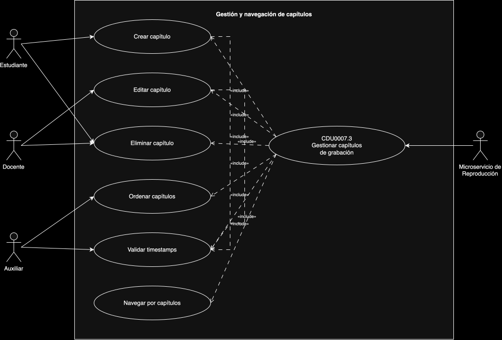

| Campo | Descripción |
|---|---|
| ID | CDU0007.3 |
| RF asociado | RF-F2-03 |
| RNF aplicables | RNF-F2-08, además de RNF-01, RNF-04, RNF-05 y RNF-06. |
| Estado de implementación | Integrado; respaldado por el [contrato gRPC](../Backend/proto/catalogo.proto), [validadores](../Backend/services/catalog-service/src/application/dto/catalog-schemas.ts), [SQL](../Backend/sql/catalogo.sql), [gestor](../Frontend/src/components/ChapterManager.tsx), [navegación](../Frontend/src/components/ChapterTimeline.tsx) y pruebas de [Catálogo](../Backend/services/catalog-service/tests/catalog-service.test.ts), [SQL](../Backend/services/catalog-service/tests/catalogo-contract.sql) y [Frontend](../Frontend/tests/chapter-components.test.tsx). |
| Nombre | Gestión y navegación de capítulos |
| Actores | Estudiante, Docente, Auxiliar y Microservicio de Reproducción |
| Descripción | Permite a docentes y auxiliares crear, editar, eliminar y ordenar capítulos temáticos de una grabación. El estudiante consulta el índice y salta al inicio de un capítulo desde el reproductor. |
| Precondiciones | Existe una grabación con duración conocida; el docente o auxiliar tiene permisos de gestión y el estudiante tiene acceso a la clase para navegar sus capítulos. |
| Postcondiciones | Los capítulos se almacenan con inicio y fin enteros, orden único, sin solapamientos y dentro de la duración; la barra y el índice permiten saltar al inicio de cada capítulo. |

Flujo principal:

| Paso | Actor | Acción |
|---|---|---|
| 1 | Docente o Auxiliar | Abre el gestor de capítulos de una grabación. |
| 2 | Docente o Auxiliar | Crea un capítulo o selecciona uno existente para editarlo, eliminarlo u ordenarlo. |
| 3 | Sistema | Ejecuta la validación de timestamps: valores enteros y no negativos, fin mayor que inicio, fin dentro de la duración y ausencia de solapamientos. |
| 4 | Sistema | Verifica que el orden sea único para la grabación y persiste el cambio. |
| 5 | Estudiante | Abre el índice o la barra segmentada durante la reproducción. |
| 6 | Estudiante | Selecciona un capítulo. |
| 7 | Microservicio de Reproducción | Lleva la reproducción al inicio del capítulo seleccionado. |

Flujos alternativos:

| ID | Condición | Acción |
|---|---|---|
| FA-01 | El docente cambia el orden de varios capítulos | El sistema recalcula la secuencia y conserva un único valor de orden por grabación. |
| FA-02 | El estudiante selecciona un capítulo mientras el video está pausado | El reproductor cambia al inicio del capítulo y conserva el estado pausado. |
| FA-03 | Se elimina un capítulo | El sistema actualiza el índice y renumera o valida el orden restante según la regla de la grabación. |

Flujos de excepción:

| ID | Condición | Acción |
|---|---|---|
| FE-01 | El fin no es mayor que el inicio o excede la duración | El sistema rechaza el capítulo y muestra la regla incumplida. |
| FE-02 | El rango se solapa con otro capítulo o duplica el orden | El sistema rechaza la operación e identifica el capítulo en conflicto. |
| FE-03 | Falla la persistencia o no se puede obtener la duración | El sistema no confirma el cambio y permite reintentar después de recuperar la dependencia. |

### CDU0007.4: Materiales adjuntos y versionado

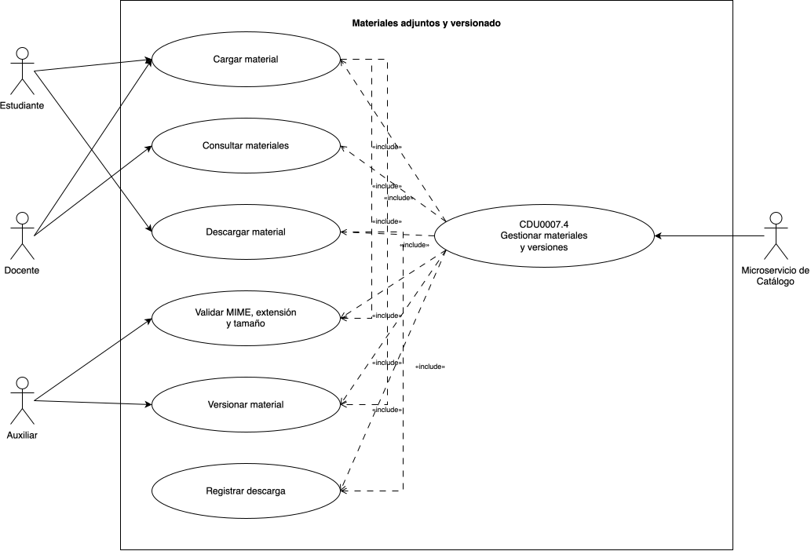

| Campo | Descripción |
|---|---|
| ID | CDU0007.4 |
| RF asociado | RF-F2-04 |
| RNF aplicables | RNF-F2-07, además de RNF-01, RNF-04, RNF-05 y RNF-06. |
| Estado de implementación | Integrado localmente; respaldado por las [rutas del Gateway](../Backend/api-gateway/src/server.ts), [validación](../Backend/api-gateway/src/validation/material.ts), [almacenamiento y versionado](../Backend/api-gateway/src/storage/storage.ts), [contrato](../Backend/proto/catalogo.proto), [SQL](../Backend/sql/catalogo.sql), [panel](../Frontend/src/components/MaterialesPanel.tsx) y pruebas de [Gateway](../Backend/api-gateway/tests/gateway-materials.test.ts), [validación](../Backend/api-gateway/tests/material-validation.test.ts), [storage](../Backend/api-gateway/tests/storage.test.ts), [GCS](../Backend/api-gateway/tests/gcs-storage.test.ts), [Catálogo](../Backend/services/catalog-service/tests/postgres-catalog-repository.test.ts) y [Frontend](../Frontend/tests/materiales-api.test.ts). |
| Nombre | Materiales adjuntos y versionado |
| Actores | Estudiante, Docente, Auxiliar y Microservicio de Catálogo |
| Descripción | Permite asociar presentaciones, guías y código fuente a una clase, consultar la versión vigente, descargar materiales, cargar nuevas versiones y registrar el conteo de descargas. |
| Precondiciones | Existe una clase; el docente o auxiliar tiene permisos para cargar materiales; el estudiante tiene permiso de lectura; el almacenamiento está disponible. |
| Postcondiciones | El material aceptado queda asociado a la clase con nombre sanitizado, versión vigente y contador de descargas; los archivos rechazados no se almacenan. |

Flujo principal:

| Paso | Actor | Acción |
|---|---|---|
| 1 | Docente o Auxiliar | Selecciona una clase y elige cargar un material. |
| 2 | Sistema | Sanitiza el nombre y valida la combinación MIME/extensión y el tamaño, con un máximo de 50 MB. |
| 3 | Sistema | Almacena el archivo y crea o incrementa su versión asociada a la clase. |
| 4 | Estudiante, Docente o Auxiliar | Consulta la lista de materiales y la versión vigente. |
| 5 | Usuario autorizado | Solicita descargar un material. |
| 6 | Microservicio de Catálogo | Entrega el archivo y registra el evento de descarga. |

Flujos alternativos:

| ID | Condición | Acción |
|---|---|---|
| FA-01 | Se carga un archivo con el mismo material lógico | El sistema conserva las versiones anteriores y marca la nueva como vigente. |
| FA-02 | El estudiante solo necesita consultar | El sistema muestra metadatos, versión y contador sin habilitar acciones de gestión. |
| FA-03 | El usuario descarga una versión anterior permitida | El sistema entrega la versión solicitada y registra la descarga con su identificador. |

Flujos de excepción:

| ID | Condición | Acción |
|---|---|---|
| FE-01 | MIME o extensión no pertenece a la allowlist | El sistema rechaza la carga e informa los tipos permitidos. |
| FE-02 | El archivo está vacío o supera 50 MB | El sistema rechaza la carga antes de persistirla. |
| FE-03 | Falla el almacenamiento o la descarga | El sistema no cambia la versión vigente, registra el error y permite reintentar. |

### CDU0007.5: Playlists de repaso

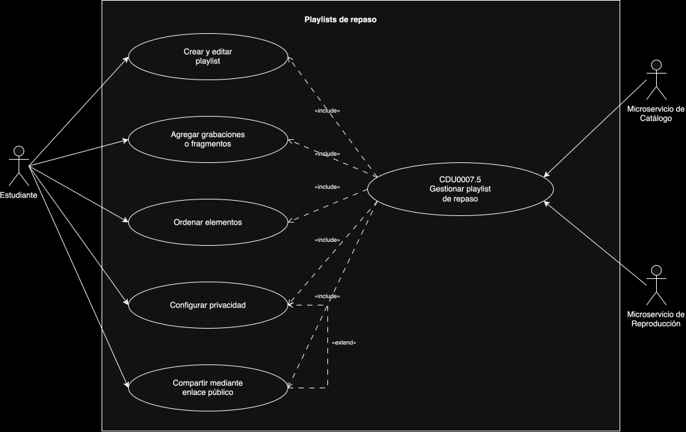

| Campo | Descripción |
|---|---|
| ID | CDU0007.5 |
| RF asociado | RF-F2-05 |
| RNF aplicables | RNF-01, RNF-04, RNF-05 y RNF-06. La privacidad, el enlace público, las pruebas y la escalabilidad quedan sujetos a los RNF-F2 de infraestructura y operación. |
| Estado de implementación | Diseño objetivo; pendiente/no evidenciado. No se encontraron modelo de datos, endpoints, componentes ni pruebas de playlists privadas o públicas. |
| Nombre | Playlists de repaso |
| Actores | Estudiante, Microservicio de Catálogo y Microservicio de Reproducción |
| Descripción | Permite crear una ruta personal de repaso con grabaciones o fragmentos de distintos cursos y semestres, ordenar sus elementos, definir privacidad y compartir una playlist pública mediante un enlace. |
| Precondiciones | El estudiante tiene una sesión activa y las grabaciones o fragmentos seleccionados están disponibles en el catálogo y pueden ser reproducidos. |
| Postcondiciones | La playlist queda guardada con nombre, orden y configuración de privacidad; si es pública, el enlace permite consultarla sin revelar playlists privadas. |

Flujo principal:

| Paso | Actor | Acción |
|---|---|---|
| 1 | Estudiante | Crea una playlist y define su nombre. |
| 2 | Estudiante | Agrega grabaciones o fragmentos provenientes de cursos y semestres distintos. |
| 3 | Sistema | Consulta el catálogo y valida que cada elemento sea accesible y reproducible. |
| 4 | Estudiante | Ordena los elementos y guarda la playlist. |
| 5 | Estudiante | Configura la playlist como privada o pública. |
| 6 | Sistema | Persiste la configuración y, cuando corresponde, genera un enlace público. |
| 7 | Usuario con el enlace | Abre la playlist pública y reproduce sus elementos mediante el Microservicio de Reproducción. |

Flujos alternativos:

| ID | Condición | Acción |
|---|---|---|
| FA-01 | La playlist es privada | Solo el propietario puede verla y modificarla desde su perfil. |
| FA-02 | El estudiante reordena o elimina un elemento | El sistema actualiza la secuencia sin modificar la grabación original. |
| FA-03 | La playlist pública se comparte nuevamente | El sistema reutiliza el enlace vigente o permite regenerarlo según la política definida. |

Flujos de excepción:

| ID | Condición | Acción |
|---|---|---|
| FE-01 | Una grabación dejó de estar disponible | El sistema marca el elemento como no disponible y permite retirarlo de la playlist. |
| FE-02 | Un visitante intenta acceder a una playlist privada | El sistema deniega el acceso y no expone sus elementos. |
| FE-03 | Falla el catálogo o la persistencia de la playlist | El sistema informa el error, no confirma el cambio parcial y permite reintentar. |

### Casos de uso de Fase 3

Estos casos amplían el modelo de fases anteriores. Las integraciones HTTP
externas salen del API Gateway; los microservicios internos conservan gRPC y
los procesos programados se ejecutan como Jobs en Kubernetes.

#### CU-F3-01 — Consultar y reproducir catálogo federado

**Actor principal:** Estudiante. **Precondición:** sesión válida; el endpoint y
la clave de consumo del aliado están configurados en el Secret runtime.

1. El estudiante abre el catálogo y solicita una búsqueda.
2. La UI combina clases locales y, si está configurado, las clases remotas.
3. El Gateway consulta al aliado con `X-API-Key`, timeout y esquema validado.
4. El adaptador normaliza metadatos, capítulos, video y origen; la UI distingue
   el contenido externo y permite abrirlo en el reproductor.
5. Si el aliado retorna 404, falla, expira el tiempo o responde fuera de
   contrato, la federación devuelve vacío/null y el catálogo local permanece
   disponible. No se persisten notas del estudiante en el sistema remoto.

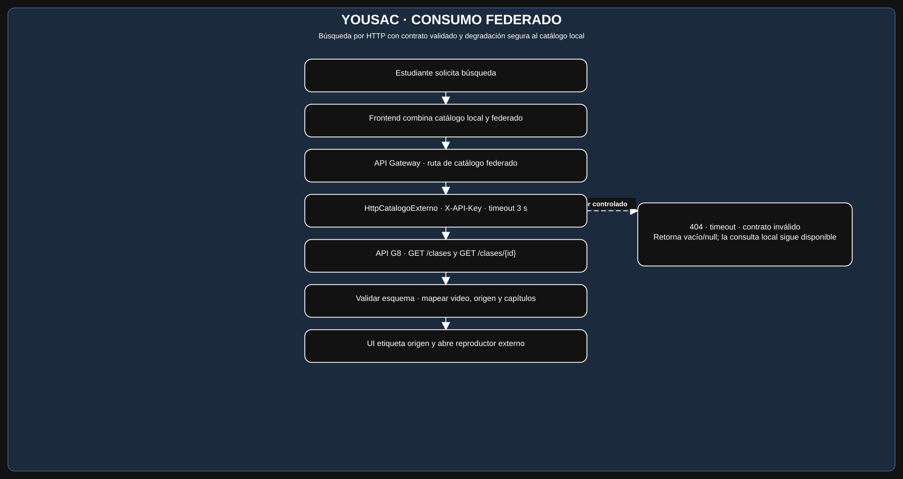
[Fuente Draw.io editable](../docs/fase3/diagramas/FlujoFederacion_F3.drawio)

#### CU-F3-02 — Interactuar con Academix Pass & CertiHub

**Actor principal:** Estudiante. **Precondición:** sesión válida y servicio
Academix configurado. El navegador solo se comunica con YoUSAC; el Gateway
deriva el nombre/correo desde la sesión y realiza las llamadas server-to-server.

1. Desde una clase, el estudiante consulta talleres filtrados por curso.
2. Al reservar, el Gateway envía evento, nombre/correo y canal `yousac` a
   Academix; la respuesta inicial es HTTP 202 y contiene el tracking.
3. La UI consulta el estado usando el tracking hasta mostrar el resultado.
4. En Perfil, consulta credenciales/certificados; puede descargar el PDF desde
   la interfaz y solicitar verificación del código.
5. Un timeout o indisponibilidad de Academix se presenta como error controlado,
   no como una sesión aceptada o reserva confirmada.

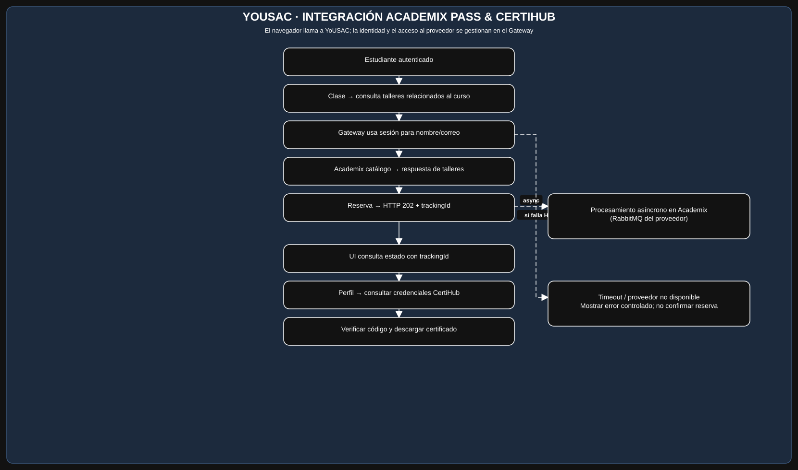
[Fuente Draw.io editable](../docs/fase3/diagramas/FlujoAcademix_F3.drawio)

#### CU-F3-03 — Ejecutar mantenimiento y avisos automatizados

**Actor principal:** Reloj/controlador de Kubernetes. Los CronJobs están en
`America/Guatemala`, usan `concurrencyPolicy: Forbid`, `backoffLimit: 2` y
guardan hasta 3 ejecuciones exitosas/fallidas.

- `yousac-purge-security`: cada día a las 00:00; conecta a Auth por Cloud SQL
  Auth Proxy y ejecuta `sp_purgar_seguridad`, que cierra sesiones inactivas,
  limpia tokens expirados y archiva auditoría antigua.
- `yousac-trends-recalc`: cada seis horas; recalcula tendencias con las últimas
  24 horas disponibles conforme al procedimiento SQL y precalienta rankings y
  tendencias en Redis mediante TTL.
- `yousac-review-notify`: cada día a las 08:00; identifica evaluaciones en los
  siguientes siete días, obtiene estudiantes matriculados, correo y clases
  mejor valoradas, y encola avisos evitando duplicar el mismo examen durante
  20 horas. El envío final corresponde al EmailWorker.

Una ejecución fallida se reintenta según el Job; debe verificarse con
`kubectl get cronjobs,jobs,pods` y logs del Job, no inferirse solo porque exista
el manifiesto.

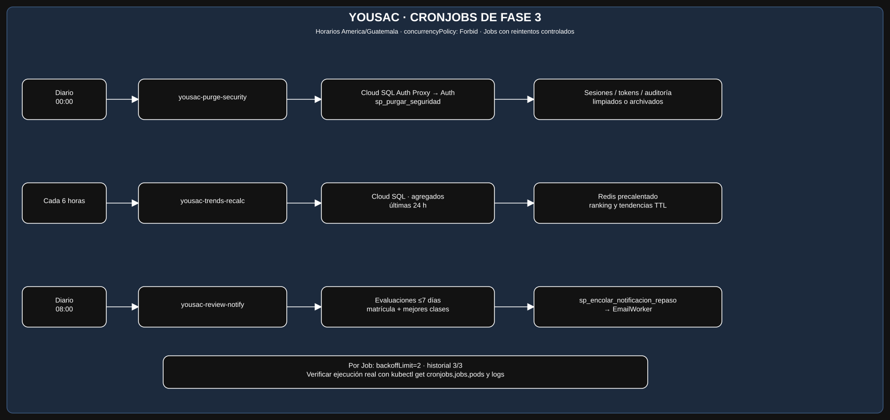
[Fuente Draw.io editable](../docs/fase3/diagramas/FlujoCronjobs_F3.drawio)

#### CU-F3-04 — Consultar recomendaciones académicas

**Actor principal:** Estudiante autenticado. Home pide recomendaciones al
Gateway; el servicio Python de Analítica consulta la función SQL y utiliza
Redis para resultados cacheados. El Gateway devuelve el resultado y Home
resuelve los datos de clase para representarlos.

**Algoritmo (filtrado colaborativo ítem-ítem).** `fn_recomendaciones_estudiante`
calcula para cada clase un puntaje de 0 a 100:

1. **Base de la comunidad** (`fn_calcular_porcentaje_recomendacion`): 70 % por
   promedio de calificaciones normalizado sobre 5 y hasta 30 % por vistas en
   escala logarítmica (`min(30, log2(vistas + 1) * 5)`).
2. **Vecinos:** estudiantes que vieron al menos una de las clases que vio el
   estudiante, pesados por cuántas clases comparten con él.
3. **Afinidad:** suma de los pesos de los vecinos que vieron cada clase,
   normalizada entre 0 y 1.
4. **Puntaje final:** `0.6 × base + 40 × afinidad`. Las clases que el
   estudiante ya vio se multiplican por 0.3 para priorizar contenido nuevo.
5. **Arranque en frío:** si el estudiante no tiene historial se usa solo la base
   de la comunidad.

La función se aplica con la migración idempotente
`k8s/migrations/sql/05_analitica_recomendacion_personalizada.sql` y el
resultado se cachea por estudiante en Redis durante 600 s.

[Fuente Draw.io editable](../docs/fase3/diagramas/FlujoRecomendacion_F3.drawio)

[Fuente Draw.io editable](Practica7/CDU/CDU_AltoNivel_P7_202307691.drawio)

## Vista de Arquitectura (Modelo 4+1)

### Vista de Escenarios
Describe los casos de uso o situaciones en las que interactúan los usuarios con el sistema. Sirve para validar que la arquitectura cubra los requisitos funcionales.

### Vista Lógica
Muestra la estructura funcional del sistema, es decir, las clases, módulos, servicios o entidades y cómo se relacionan entre sí para implementar la lógica del negocio.

Los diagramas de secuencia disponibles para esta sección corresponden a los
CDU 1–12. Para los CDU 13–27 se conservan los diagramas de actividad en la
Vista de Procesos (sección siguiente), en lugar de dejar referencias a
secuencias que no están incluidas en el repositorio.

#### Vista lógica actualizada de Fase 2

La vista lógica de Fase 2 extiende la separación de presentación, API Gateway,
Catálogo, Reproducción y persistencia para los cinco casos de uso más recientes
del módulo 7. La vista consolidada resume las interacciones y cada caso cuenta
con su secuencia detallada.

[Fuente editable de la vista consolidada](Vistas4+1/XML/VistaLogica_DiagramaSecuencia_F2_G4.drawio)

[Fuente editable CDU0007.1](Vistas4+1/XML/VistaLogica_DiagramaSecuencia_CDU7.1_F2_G4.drawio)

[Fuente editable CDU0007.2](Vistas4+1/XML/VistaLogica_DiagramaSecuencia_CDU7.2_F2_G4.drawio)

[Fuente editable CDU0007.3](Vistas4+1/XML/VistaLogica_DiagramaSecuencia_CDU7.3_F2_G4.drawio)

[Fuente editable CDU0007.4](Vistas4+1/XML/VistaLogica_DiagramaSecuencia_CDU7.4_F2_G4.drawio)

[Fuente editable CDU0007.5](Vistas4+1/XML/VistaLogica_DiagramaSecuencia_CDU7.5_F2_G4.drawio)

### Vista de Procesos
Representa cómo se comunican y coordinan los procesos o servicios del sistema durante la ejecución. Esta vista muestra las llamadas remotas entre servicios, el intercambio de datos y la concurrencia.

#### Funcionalidades Fase 2

### Vista de Componentes
Describe la organización del software en componentes o módulos, mostrando cómo se divide el sistema, sus dependencias y la función de cada parte.

[Fuente editable de la vista de componentes Fase 2](Vistas4+1/XML/VistaComponentes_DiagramaComponentes_F2_G4.drawio)

### Vista de Despliegue
Explica cómo se distribuye el sistema en la infraestructura física o virtual, indicando servidores, contenedores, dispositivos, redes y dónde se ejecuta cada componente.

[Archivo editable del diagrama de despliegue Fase 2](Vistas4+1/XML/VistaComponentes_DiagramaDespliegue_F2_G%234.drawio)

### Vistas 4+1 consolidadas para Fase 3

Las vistas siguientes son los diagramas de Fase 3 que se actualizaron sobre los
archivos de Práctica 7. Conservan el tipo y el estilo de cada vista original;
ahora representan YoUSAC y dejan a Academix Pass, CertiHub y el grupo federado
como proveedores externos. Los diagramas de Fases 1 y 2 que aparecen antes se
conservan como contexto histórico, no como topología final.

[Fuente editable de la composición 4+1](Practica7/Vistas4+1/XML/Vista4+1_Practica7_G4.drawio)

#### Vista de escenarios (+1)

[Fuente editable](Practica7/CDU/CDU_AltoNivel_P7_202307691.drawio)

#### Vista lógica

La secuencia muestra las llamadas autenticadas de YoUSAC a Academix Pass y
CertiHub. El navegador no invoca al proveedor directamente; las reservas
devuelven un `trackingId` y el estado se consulta después.

[Fuente editable](Practica7/Vistas4+1/XML/VistaLogica_DiagramaSecuencia_P7_G4.drawio)

#### Vista de procesos

Separa el tráfico síncrono gRPC/HTTP del Gateway, las llamadas HTTP
server-to-server y las tareas programadas. La reserva asíncrona se procesa en
Academix: YoUSAC recibe un tracking y consulta posteriormente el estado; no
incorpora un broker propio para esa reserva.

[Fuente editable](Practica7/Vistas4+1/XML/VistaProcesos_DiagramaActividades_P7_G4.drawio)

#### Vista de componentes

La frontera del proveedor distingue el cliente REST que vive en YoUSAC del
API, RabbitMQ y worker que pertenecen a Academix; CertiHub y el catálogo G8
también son dependencias externas.

[Fuente editable](Practica7/Vistas4+1/XML/VistaDespliegue_Practica7_G4.drawio.xml)

#### Vista de despliegue

La VPC `vpc-yousac` (`10.20.0.0/16`) separa subred perimetral
(`10.20.1.0/24`), aplicación (`10.20.2.0/24`) y datos (`10.20.3.0/24`).
Las VMs no tienen IP pública y usan Cloud NAT para salida; el acceso SSH/Ansible
se realiza por IAP. El GKE Autopilot productivo existente permanece en la red
`default` y se conecta a la VPC por peering. Cloud SQL, Redis, GCS y Artifact
Registry son dependencias externas a los pods; el preflight admite Redis en la
VM `yousac-vm-nube` o Memorystore. Terraform adopta GKE/Cloud SQL/Registry/
buckets/IP con bloques `import` y no crea una nueva VPC para migrar el clúster.

[Fuente editable](Practica7/Vistas4+1/XML/VistaFisica_Practica7_G4.drawio.xml)

### Arquitectura de alto nivel / bloques

Kibana llega a la VM de observabilidad a través del peering y del Ingress;
Grafana se publica en el Ingress de GKE. Fluent Bit en GKE y en las VMs entrega
logs a Logstash; Prometheus de GKE recoge métricas de Kubernetes, Gateway,
Redis Exporter y node-exporter de las VMs. El catálogo federado y Academix son
servicios externos.

[Fuente editable](../docs/fase3/diagramas/Arquitectura_AltoNivel_F3.drawio)

## Matriz de decisiones técnicas

La selección se justifica por el problema concreto que resuelve en YoUSAC; no
se interpreta como una comparación universal de productos.

| Tecnología/decisión | Qué se utiliza | Por qué | Para qué en YoUSAC |
|---|---|---|---|
| Terraform | Proveedor Google, módulos `.tf`, estado remoto GCS y bloques `import`. | Mantener recursos declarativos, revisar el plan antes de cambiar cloud y adoptar recursos productivos sin recrearlos. | VPC/subredes, NAT, peering, firewall, VMs, IAM, buckets y adopción de GKE/Cloud SQL/Registry/IP existentes. |
| Ansible | Inventario generado y playbooks/roles idempotentes. | Separar configuración del SO de la creación de recursos cloud y reducir pasos manuales repetidos. | Hardening/paquetes, Docker/Compose, node-exporter, Fluent Bit y ELK en hosts apropiados. |
| ELK | Fluent Bit → Logstash → Elasticsearch → Kibana. | Centralizar, normalizar, indexar y filtrar eventos fuera de cada contenedor/host. | Diagnóstico y consulta de eventos de aplicación/auditoría desde Kibana. |
| Prometheus | Prometheus gestionado/kube-prometheus-stack, ServiceMonitors y exporters. | Obtener series temporales consultables con descubrimiento de targets de Kubernetes. | Métricas de pods/nodos, Gateway, tareas y Redis; alimentar tableros. |
| Grafana | Dos dashboards: infraestructura y negocio/tareas. | Facilitar lectura visual de métricas con paneles reutilizables y filtros temporales. | Supervisar salud/recursos y actividad/tendencias; el acceso Viewer no debe exponer secretos. |
| Smoke Tests | Peticiones HTTP y estado del Ingress después del rollout. | Las pruebas unitarias no demuestran que Ingress, certificado, Gateway y frontend sean alcanzables en el destino. | Detener el CD si `/`, `/healthz`, `/api/health` o backends no están sanos. |
| Algoritmo de recomendación | Filtrado colaborativo ítem-ítem en SQL (`fn_recomendaciones_estudiante`) sobre la base de comunidad (rating y vistas), servido por Analítica vía gRPC y cacheado en Redis. | Usa datos que ya existen (vistas y calificaciones), es explicable y auditable, y no requiere entrenar ni desplegar un modelo externo. | Mostrar en Home “Clases recomendadas para tu preparación de exámenes” distintas para cada estudiante según lo que vieron estudiantes con historial parecido. |

## Matriz de aplicación SOLID en integraciones

La evidencia se concentra en el API Gateway como frontera entre YoUSAC y sus
proveedores externos. La matriz describe el diseño observado; los tests
sustituyen dependencias para aislar contratos.

| Principio | Dónde | Cómo | Por qué / evidencia |
|---|---|---|---|
| SRP — Responsabilidad única | `federation/catalogo-externo.ts`, `federation/mapper.ts`, `academix/client.ts`, rutas de `server.ts`. | El adaptador gestiona HTTP/timeout/esquema; el mapper transforma datos; las rutas coordinan; la UI representa. | Evita mezclar transporte, mapeo y presentación; hay responsabilidades distinguibles y suites específicas. |
| OCP — Abierto/cerrado | Puerto `CatalogoExterno`, fábrica `crearCatalogoExterno` e interfaz `AcademixApi`. | El consumidor usa contratos; tests pueden inyectar dobles y otro adaptador puede respetar el mismo contrato. | Permite sustituir proveedores preservando consumidores, sujeto al contrato y sus esquemas. |
| LSP — Sustitución de Liskov | Implementación `HttpCatalogoExterno` y dobles de prueba; contrato `AcademixApi`. | Las implementaciones respetan formas de resultado, errores y tiempos que espera el consumidor. | Las pruebas recorren los flujos con respuestas controladas; fallos remotos federados se traducen a vacío/null. |
| ISP — Segregación de interfaces | `CatalogoExterno` (`buscar`, `obtener`) y `AcademixApi` (`talleres`, `reservar`, `estadoReserva`, `credenciales`, `verificar`). | Cada proveedor expone operaciones de su dominio, en vez de una interfaz genérica para todo el sistema. | Reduce dependencias irrelevantes; el consumidor llama solo a la API requerida por su función. |
| DIP — Inversión de dependencias | Rutas del Gateway reciben contratos/fábricas inyectables; `server.ts` conecta configuración con adapters. | Las páginas llaman a YoUSAC; las llamadas externas y secretos se quedan en el servidor. | Centraliza timeout, seguridad y manejo de errores y permite pruebas aisladas de la red/proveedor. |

**Límites observados:** la federación degrada errores a vacío/null; Academix
devuelve errores de disponibilidad controlados. La clave remota permanece en
el Secret `yousac-runtime` y no se registra en logs ni en esta documentación.
SOLID facilita sustituibilidad, pero no reemplaza autorización, validación,
monitoreo ni pruebas del proveedor real.

## Diagrama de flujo del pipeline CI/CD

El workflow de pruebas (`unit-tests.yml`) corre en `push` y Pull Request a
`main`/`develop`; los seis paquetes Jest tienen umbral de 75% para líneas y
sentencias, y Go/Python aplican sus umbrales en el workflow/configuración.
`ci-cd.yml` se activa por push a `main`, tags semánticos `vX.Y.Z`/`VX.Y.Z`,
Pull Request a `main` o ejecución manual. La publicación/despliegue solo
continúa con push/tag permitido o `workflow_dispatch` en `main`. Tras pruebas,
publica ocho imágenes en Artifact Registry con alias y `commit-<SHA>` inmutable;
actualiza la VM de desarrollo y, para `main`, autentica por WIF, ejecuta el
preflight, aplica Kustomize, espera ocho rollouts, el ManagedCertificate y los
backends HEALTHY, y realiza smoke tests HTTPS (`/`, `/healthz`, `/api/health`).
Si algo falla, el flujo se detiene; GKE permite revertir el Deployment afectado
con `kubectl rollout undo`.

[Fuente editable del pipeline](../docs/fase3/diagramas/Pipeline_CICD_F3.drawio)

## Diseño del Modelado de Datos (DER)

### Auth Service

### Objetos programables
| Tipo | Nombre | Descripción |
|---|---|---|
| SP | sp_registrar_usuario | Valida el dominio institucional (llama a fn_validar_dominio_correo) e inserta el usuario junto con su rol por defecto (Estudiante). |
| SP | sp_asignar_rol | Agrega un nuevo perfil/rol a un usuario existente (soporta multiperfil). |
| SP | sp_cambiar_password | Actualiza credenciales dentro de una transacción; dispara el trigger de auditoría. |
| SP | sp_vincular_cuenta_oauth | Vincula un proveedor OAuth institucional a un usuario existente (o lo crea si no existe). |
| SP | sp_solicitar_reset_password | Genera un token_verificacion de tipo RESET_PASSWORD con fecha de expiración. |
| SP | sp_confirmar_verificacion | Valida un token (VERIFICACION_CORREO o RESET_PASSWORD), lo marca como usado y aplica el efecto correspondiente. |
| Vista | vw_usuarios_activos_roles | Usuarios activos con el listado agregado de todos sus roles/perfiles disponibles. |
| Vista | vw_sesiones_activas | Sesiones vigentes (no expiradas) por usuario, usadas por el API Gateway para validación rápida. |
| Función | fn_validar_dominio_correo(correo) | Valida que el correo pertenezca a @ingenieria.usac.edu.gt o @ing.usac.edu.gt. |
| Función | fn_tiene_permiso(rol_id, recurso, accion) | Evalúa la matriz RBAC contra permiso_rbac. |
| Trigger | trg_auditoria_password | AFTER UPDATE OF hash_password ON usuario → inserta un registro en auditoria_credenciales. |
| Trigger | trg_auditoria_rol | AFTER INSERT OR DELETE ON usuario_rol → registra cambios de permisos/roles en auditoria_credenciales. |
| Trigger | trg_marcar_verificado | AFTER UPDATE OF usado ON token_verificacion (tipo VERIFICACION_CORREO) → marca usuario.email_verificado = true. |

### Inscripción Service

### Objetos programables

| Tipo | Nombre | Descripción |
|---|---|---|
| SP | sp_inscribir_estudiante | Valida cupo/duplicidad e inserta la inscripción con estado inicial PENDIENTE. |
| SP | sp_asignar_catedratico_curso | Asigna un catedrático como titular de un curso. |
| SP | sp_asignar_auxiliar_catedratico | Vincula un auxiliar a un catedrático específico (no directamente al curso). |
| Vista | vw_panel_estudiante | Cursos inscritos, estado de matrícula y catedrático asignado, por estudiante. |
| Vista | vw_cursos_por_catedratico | Cursos asignados junto con los auxiliares que apoyan a cada catedrático. |
| Función | fn_estado_matricula(estudiante_id_ref, curso_id) | Calcula el estado vigente de matrícula (ACTIVA, PENDIENTE, RETIRADA). |
| Trigger | trg_auditoria_inscripcion | AFTER UPDATE OF estado_matricula ON inscripcion → registra el cambio de estado en una tabla de auditoría local. |
| Trigger | trg_validar_auxiliar_unico_catedratico | BEFORE INSERT ON asignacion_auxiliar → evita asignaciones duplicadas del mismo auxiliar al mismo catedrático. |

### Catálogo Service

### Objetos programables

| Tipo | Nombre | Descripción |
|---|---|---|
| SP | sp_publicar_clase | Inserta la clase y dispara el trigger de evento de publicación. |
| SP | sp_asociar_etiquetas | Inserta múltiples relaciones clase_etiqueta en una sola transacción. |
| Vista | vw_ficha_tecnica_clase | Combina clase_grabada, curso_catalogo, docente_clase y clase_etiqueta en una sola proyección lista para el frontend. |
| Vista | vw_catalogo_por_semestre | Listado de clases agrupado por semestre/año/escuela. |
| Función | fn_buscar_clases | Búsqueda avanzada con filtros opcionales combinables (semestre, escuela, curso, catedrático, tema). |
| Trigger | trg_evento_clase_publicada | AFTER INSERT ON clase_grabada → inserta un registro en evento_publicacion_pendiente, consumido por el Notificaciones Service vía gRPC. |

### Reproducción Service

### Objetos programables

| Tipo | Nombre | Descripción |
|---|---|---|
| SP | sp_guardar_checkpoint | Hace *upsert* de historial_reproduccion y checkpoint en una sola transacción (alta concurrencia). |
| SP | sp_registrar_calificacion | Inserta o actualiza la calificación asociada a un historial_id existente. |
| Vista | vw_historial_reciente | Últimas clases vistas por estudiante ordenadas por fecha_ultima_visualizacion, con el porcentaje de avance. |
| Función | fn_calcular_progreso(segundo_actual, duracion_total_segundos) | Calcula el porcentaje de avance del video. |
| Trigger | trg_actualizar_historial | AFTER INSERT OR UPDATE ON checkpoint → actualiza fecha_ultima_visualizacion en historial_reproduccion. |
| Trigger | trg_validar_rango_puntuacion | BEFORE INSERT OR UPDATE ON calificacion → valida que puntuacion esté entre 1 y 5. |

### Analítica Service

### Objetos programables

| Tipo | Nombre | Descripción |
|---|---|---|
| SP | sp_registrar_evento_vista | Hace *upsert* de clase_metrica (si es la primera vez que se ve esa clase) e inserta el evento_vista. Alimentado por Reproducción Service. |
| SP | sp_recalcular_tendencias | Agrega evento_vista por clase para una semana dada y regenera tendencia_semanal (job programado). |
| Vista | vw_ranking_clases | Top de clases por total_vistas y promedio_calificacion. |
| Vista | vw_tendencias_examenes | Temas con mayor crecimiento de vistas en las últimas semanas. |
| Función | fn_calcular_porcentaje_recomendacion(clase_metrica_id) | Combina calificacion_agregada y tendencia_semanal en un puntaje ponderado de recomendación. |
| Trigger | trg_actualizar_calificacion_agregada | AFTER INSERT ON evento_vista (o al sincronizar calificaciones desde Reproducción Service) → recalcula promedio_calificacion y total_calificaciones. |
| Trigger | trg_invalidar_cache_ranking | AFTER INSERT OR UPDATE ON tendencia_semanal → marca bandera de control para invalidar (TTL forzado) la clave correspondiente en Redis. |

### Notificaciones Service

### Objetos programables

| Tipo | Nombre | Descripción |
|---|---|---|
| SP | sp_registrar_notificacion | Inserta la notificación con estado PENDIENTE (dispara trigger de encolado). |
| SP | sp_marcar_enviada | Actualiza estado a ENVIADA y sincroniza fecha_envio. |
| Vista | vw_notificaciones_pendientes | Notificaciones con estado = 'PENDIENTE' listas para procesar por el worker de correo. |
| Función | fn_renderizar_plantilla(plantilla_id, datos_contexto) | Sustituye variables dinámicas dentro del cuerpo_html de la plantilla. |
| Trigger | trg_encolar_notificacion | AFTER INSERT ON notificacion → inserta automáticamente el registro correspondiente en cola_envio. |
| Trigger | trg_reintento_fallido | AFTER UPDATE OF ultimo_error ON cola_envio → incrementa intentos y calcula fecha_proximo_intento con backoff. |

## Diseño UI/UX (Mockups)

### Login Institucional
Este mockup representa la pantalla de autenticación del sistema. Permite a estudiantes y docentes iniciar sesión utilizando exclusivamente su correo institucional de la Facultad de Ingeniería, validando el dominio permitido y garantizando un acceso seguro a la plataforma.

### Catálogo
Corresponde a la interfaz principal donde los usuarios pueden explorar el contenido disponible. Incluye herramientas de búsqueda y filtros por semestre, curso, escuela, catedrático y temas específicos, facilitando la localización de las grabaciones académicas.

### Reproductor
Muestra la pantalla destinada a la reproducción de las clases grabadas. Además del reproductor multimedia, presenta información de la clase, el progreso de visualización (checkpoint), la opción de calificar el contenido y el porcentaje de recomendación generado por el sistema.

### Asignaciones
Este mockup permite al usuario consultar los cursos en los que está inscrito y visualizar la información relacionada con sus asignaciones académicas. También refleja los permisos disponibles según el rol del usuario dentro de la plataforma.

### Configuración
Representa la sección donde el usuario puede administrar la información de su perfil, modificar preferencias personales, gestionar la seguridad de su cuenta y visualizar los datos asociados a su sesión.

### Panel Admin
Corresponde a la interfaz exclusiva para administradores del sistema. Desde este panel es posible gestionar usuarios, cursos, grabaciones, permisos y otros elementos administrativos necesarios para el funcionamiento de la plataforma.

### Panel Anotaciones
Corresponde a la interfaz exclusiva para administradores del sistema. Desde este panel es posible gestionar usuarios, cursos, grabaciones, permisos y otros elementos administrativos necesarios para el funcionamiento de la plataforma.

### Panel Foro Dudas de estudiantes
Corresponde a la interfaz exclusiva para administradores del sistema. Desde este panel es posible gestionar usuarios, cursos, grabaciones, permisos y otros elementos administrativos necesarios para el funcionamiento de la plataforma.

### Panel Gestion de Playlist
Corresponde a la interfaz exclusiva para administradores del sistema. Desde este panel es posible gestionar usuarios, cursos, grabaciones, permisos y otros elementos administrativos necesarios para el funcionamiento de la plataforma.

### Panel Segmentación de Capitulos
Corresponde a la interfaz exclusiva para administradores del sistema. Desde este panel es posible gestionar usuarios, cursos, grabaciones, permisos y otros elementos administrativos necesarios para el funcionamiento de la plataforma.

## Manuales operativos complementarios

La operación paso a paso se separa del documento técnico para facilitar su uso
durante la entrega y la demostración:

- [Manual de despliegue — Fase 3](Manual_Despliegue_Fase3.md): Terraform,
  Ansible, despliegue CI/CD en GKE, validación, diagnóstico y rollback seguro.
- [Manual de usuario](Manual_Usuario_Fase3.md): instrucciones diferenciadas
  para estudiante, auxiliar/catedrático y administrador, con espacios
  identificados para capturas reales.

## Conclusión

La documentación consolida los requisitos y diseños de las tres fases con la
implementación visible en este repositorio: arquitectura de microservicios
Go/TypeScript/Python, Gateway y gRPC; catálogo federado e integración
server-to-server con Academix; tareas programadas; Terraform y Ansible;
observabilidad Prometheus/Grafana y ELK; y el flujo CI/CD hacia VM/GKE. Las
vistas 4+1, casos de uso, arquitectura de alto nivel y pipeline se entregan en
formato de lectura y con sus fuentes editables.

La existencia de manifiestos, workflows o código no demuestra por sí sola que
la infraestructura esté saludable ni que cada operación haya sido probada en
producción. Por eso se distinguen los componentes implementados de las
validaciones pendientes de evidencia cloud. También quedan visibles las
limitaciones encontradas —en particular, la personalización de
recomendaciones y las exportaciones/auditoría del panel— para orientar el
cierre funcional sin afirmar capacidades no verificadas.
