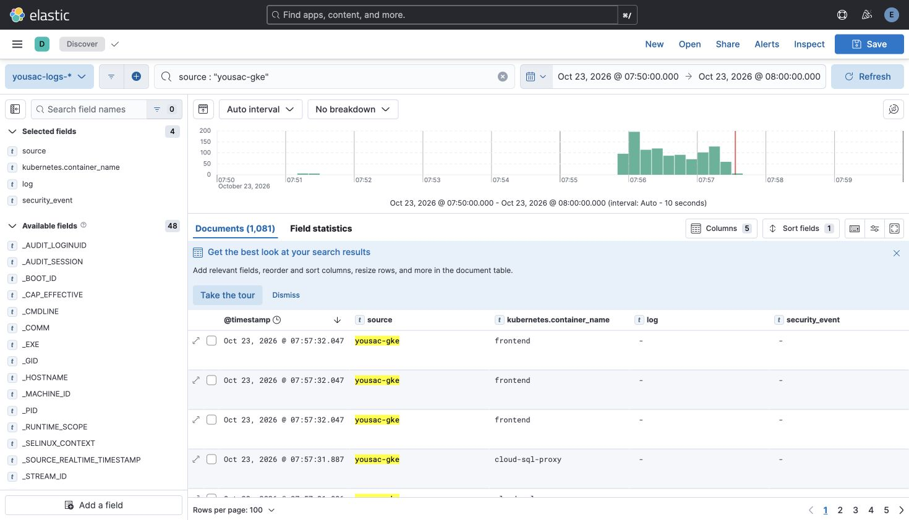
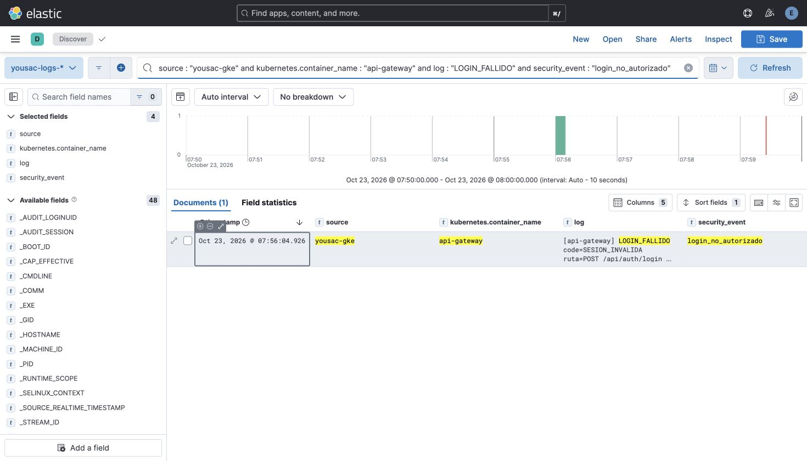

# Verificación del 23 de octubre de 2026

Contexto explícito: `gke_yousac-202300396-2026_us-central1_yousac-prod`. VM: `vm-observability-yousac`, proyecto `yousac-202300396-2026`, zona `us-central1-a`.

## Resultado y límite de la evidencia

Se envió **un solo login HTTP** a `https://yousac-thany.duckdns.org/api/auth/login`, con correo ficticio `verificacion-elk-20261023@ingenieria.usac.edu.gt` y contraseña desechable. Respondió **401**, `SESION_INVALIDA`, `Credenciales incorrectas`. Un intento previo desde Python falló en la verificación del almacén local de certificados antes de enviar HTTP; curl verificó TLS y completó la única petición.

Gateway, pod `api-gateway-6b49d44948-g4j4d`:

```text
[api-gateway] LOGIN_FALLIDO code=SESION_INVALIDA ruta=POST /api/auth/login ip=::ffff:35.191.17.214 detalle="Credenciales incorrectas"
```

El evento llegó naturalmente por GKE a Elasticsearch a `2026-10-23T13:56:04.926504121Z` (hora del registro CRI: `2026-10-23T13:56:04.290356264Z`). El parser CRI incluido en Fluent Bit 5.1.5 entregaba `message`, no `log`. Ya tenía `source=yousac-gke`, metadata del gateway, `stream=stderr` y `security_event=login_no_autorizado`; todavía tenía `service=yousac-gke` y faltaba `log`.

Se corrigió el manifiesto con un parser CRI explícito que conserva `log`, y se completó otro rollout 3/3. Se verificaron eventos nuevos con `log` sin intervención. Para respetar el límite de un solo login, **se normalizó exclusivamente el documento real existente** mediante `_update` con control de concurrencia (`if_seq_no`/`if_primary_term`): copiar su `message` original a `log`, extraer `service=api-gateway` y quitar el prefijo de `message`. No se alteraron ID, tiempo, origen, metadata, stream ni clasificación; no se creó otro evento de login.

**La captura del login muestra ese documento normalizado. No demuestra un login nuevo de extremo a extremo con la configuración final.** Esa configuración se verificó mediante prueba real de CRI, aserciones sobre el filtro real de Logstash y recepción de logs nuevos con `log`. No se generó un segundo login.

Índice: `yousac-logs-2026.10.23`. ID: `S7cMaaEBYRpTFWrBKhwR` (versión final 2).

## Consultas y capturas

Data view: `yousac-logs-*`. Intervalo absoluto UTC: **2026-10-23 13:50:00Z–14:00:00Z**. Kibana muestra las horas locales UTC−6 (07:50–08:00).

| Consulta KQL | Resultados |
| --- | ---: |
| `source : "yousac-gke"` | 1,081 en la captura; 1,820 al consultar después |
| `source : "yousac-gke" and kubernetes.container_name : "api-gateway" and log : "LOGIN_FALLIDO" and security_event : "login_no_autorizado"` | 1, documento normalizado descrito arriba |
| `source : "yousac-vm"` | 843 al consultar después |

La ventana aún estaba abierta cuando se consultó; los totales de GKE y VM aumentan con la ingesta. [results.json](results.json) contiene el resultado posterior y el evento exacto.





## Infraestructura y pruebas

- DaemonSet: 3 deseados, 3 listos, 3 disponibles en los tres nodos Linux, imagen `cr.fluentbit.io/fluent/fluent-bit:5.1.5`.
- Kustomize del recolector y del padre construidos; dry run del servidor aceptado por Autopilot; prueba nativa de configuración Fluent Bit exitosa.
- Parser CRI ejecutado con imagen 5.1.5, una línea realista y salida aislada: conserva texto en `log` y `stream=stderr`.
- Filtro completo generado desde la plantilla real y ejecutado con Logstash 8.15.3, sin Elasticsearch: aserciones de servicio, mensaje, stream y clasificación correctas. Los errores del comprobador de licencia del contenedor aislado no impidieron el evento ni las aserciones.
- Ansible: sintaxis válida; comprobaciones posteriores `--check` de pipeline y fusión de Docker sin cambios; ejecución limitada a la única VM, etiquetas `elk_pipeline,elk_rotation`, sin tareas de contraseñas ni dashboards. `dockerd --validate` aceptó el archivo; Docker reiniciado y cuatro servicios recreados sin borrar volúmenes. Se ajustó después el handler de pipeline para reiniciar solo Logstash en futuras ejecuciones.
- Los cuatro contenedores (`yousac-elasticsearch`, `yousac-logstash`, `yousac-kibana`, `yousac-caddy-elk`) tienen `HostConfig.LogConfig={"Type":"json-file","Config":{"max-file":"3","max-size":"10m"}}`.
- Elasticsearch HTTP 200: `yellow`, 37 primarios activos, 4 shards sin asignar en un único nodo. Kibana HTTP 200: `available`. El endpoint público volvió a servir Discover.
- Durante la interrupción se observaron reintentos y luego envíos exitosos del buffer. El cambio de parser reemplazó pods y pudo perder pendientes de `emptyDir`; no se afirma entrega sin pérdidas.
- El documento de prueba `yousac-logs-2026.10.21/8OtxXKEBZKCk3GvBxseH` se inspeccionó primero (origen y servicio de prueba, marcador de prueba y LOGIN_FALLIDO), se borró solo por ese ID y la lectura posterior respondió 404.

El Compose local pasó `config --quiet`. No se levantó el entorno de aplicación local: Docker Desktop estaba apagado. Las pruebas de contenedores se ejecutaron en la VM; no hubo cambios de aplicación, secretos, firewall, `main` ni otros namespaces. El PR no fusiona #95 ni sus eliminaciones ajenas.
